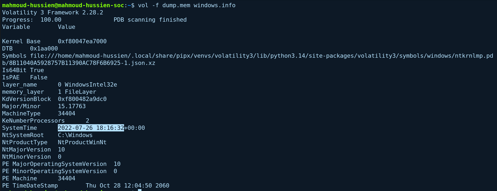
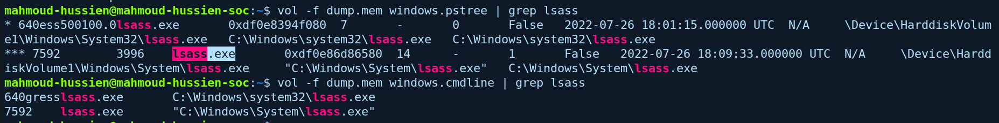
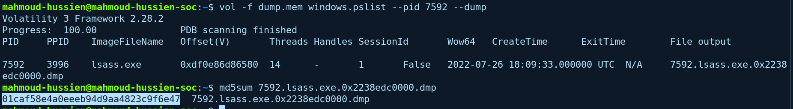
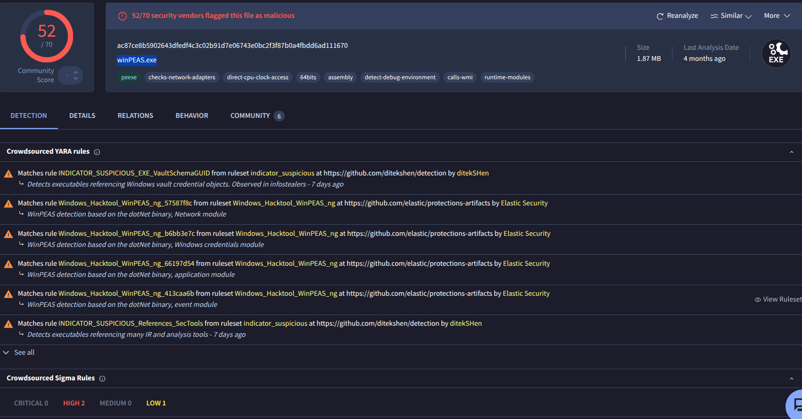
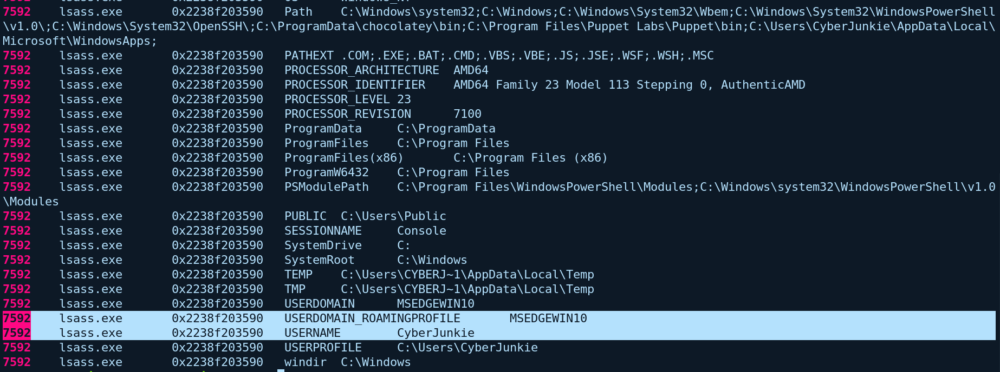
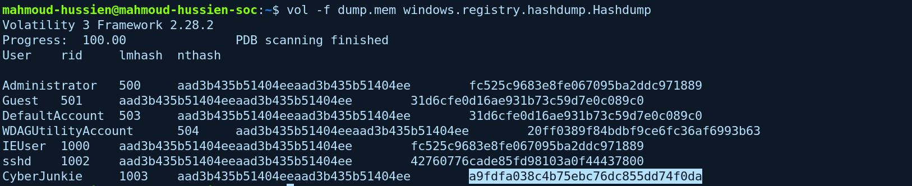
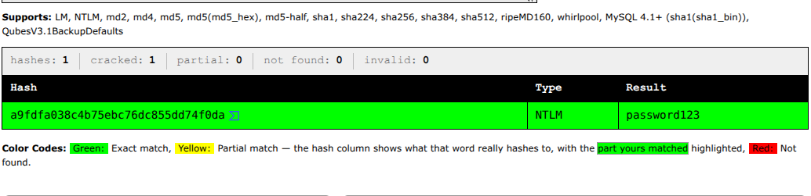

## Scenario Overview

A Windows endpoint was compromised and the EDR/IDS raised an alert, which was escalated to Tier 2 (Incident Responders). The task is to analyze the memory dump of the compromised host and answer five questions: when the memory was acquired, which process is suspicious, which attacker tool is running, which account is compromised, and what that account's password is.

---

## Investigation Overview

```
[1] Memory acquisition time
    └─ windows.info → 2022-07-26 18:16:32 UTC

[2] Suspicious process
    └─ lsass.exe (PID 7592) running from C:\Windows\System\
    └─ Real lsass.exe lives in C:\Windows\System32\

[3] Attacker tool
    └─ Dump PID 7592's image → MD5 → VirusTotal
    └─ Detected as winpeas.exe (52/70)

[4] Compromised account
    └─ Environment variables of PID 7592
    └─ MSEDGEWIN10\CyberJunkie

[5] Password
    └─ hashdump → NTLM of CyberJunkie → CrackStation
    └─ password123
```

---

## Question 1 — What was the date and time when memory from the compromised endpoint was acquired?

### Volatility Command

```bash
vol -f dump.mem windows.info
```

### Investigation

`windows.info` reads the kernel debugger structures in the image and prints OS metadata, including the system clock at acquisition. It is the first command to run on any image: every process time, connection state and log timestamp in the dump is relative to this moment.

| Field | Value |
|---|---|
| SystemTime | `2022-07-26 18:16:32+00:00` |
| OS | Windows 10 (Build 17763), 64-bit |

### Answer

```
2022-07-26 18:16:32
```


---

## Question 2 — What was the suspicious process running on the system?

### Volatility Commands

```bash
vol -f dump.mem windows.pstree | grep lsass
vol -f dump.mem windows.cmdline | grep lsass
```

### Investigation

Searching the process tree and the command lines for `lsass` returns an instance that doesn't match the legitimate Local Security Authority Subsystem Service:

| Field | Legitimate `lsass.exe` | Suspicious instance |
|---|---|---|
| Path | `C:\Windows\System32\lsass.exe` | `C:\Windows\System\lsass.exe` |
| PID | — | `7592` |
| PPID | — | `3996` |

The suspicious process runs from `C:\Windows\System\` instead of `C:\Windows\System32\`, a folder that normally holds no system binaries. The attacker kept the name of a process defenders expect to see, and chose a path that looks close enough to pass a glance at the process list. The real `lsass.exe` runs only once and always from `System32`, so a second instance from a different path is a strong masquerading indicator.

**MITRE ATT&CK:** T1036.005 — Masquerading: Match Legitimate Name or Location

### Answer

```
lsass.exe
```


---

## Question 3 — What is the malicious tool running on the system?

### Volatility Commands

```bash
vol -f dump.mem windows.pslist --pid 7592 --dump
md5sum 7592.lsass.exe.0x2238edc0000.dmp
```

### Investigation

Because the process name is a disguise, the process itself had to be identified by its content.

**Step 1 — Dump the executable image of PID 7592:**

```bash
vol -f dump.mem windows.pslist --pid 7592 --dump
```

This writes the process image to `7592.lsass.exe.0x2238edc0000.dmp`.

**Step 2 — Hash it:**

```bash
md5sum 7592.lsass.exe.0x2238edc0000.dmp
```

```
01caf58e4a0eeeb94d9aa4823c9f6e47
```


**Step 3 — Look the hash up on VirusTotal:**

| Field | Value |
|---|---|
| Detections | 52 / 70 vendors |
| Identified as | `winpeas.exe` |
| YARA | `Windows_Hacktool_WinPEAS_ng` |

**WinPEAS** (Windows Privilege Escalation Awesome Script) is a post-exploitation enumeration tool. It scans a host for misconfigurations that allow escalation: weak service permissions, unquoted service paths, stored credentials, writable folders, and similar. Its presence confirms the attacker was looking for a way to raise privileges on this machine.

**MITRE ATT&CK:** T1082 — System Information Discovery (enumeration performed by WinPEAS)

### Answer

```
winpeas.exe
```


---

## Question 4 — Which user account was compromised?

### Volatility Command

```bash
vol -f dump.mem windows.envars.Envars | grep 7592
```

### Investigation

`windows.envars.Envars` lists the environment variables of each process. Filtering for PID `7592` shows the account context the malicious process was running under:

| Variable | Value |
|---|---|
| `USERDOMAIN` | `MSEDGEWIN10` |
| `USERNAME` | `CyberJunkie` |
| `USERPROFILE` | `C:\Users\CyberJunkie` |

The domain here is the machine name (`MSEDGEWIN10`), which means a **local account** on that host, not a domain account.

**MITRE ATT&CK:** T1078.003 — Valid Accounts: Local Accounts

### Answer

```
msedgewin10/cyberjunkie
```


---

## Question 5 — What is the compromised user's password?

### Volatility Command

```bash
vol -f dump.mem windows.registry.hashdump.Hashdump
```

### Investigation

The `hashdump` plugin reads the `SYSTEM` and `SAM` registry hives from memory and extracts the local account hashes. Output:

| User | RID | LM hash | NT hash |
|---|---|---|---|
| Administrator | 500 | `aad3b435b51404eeaad3b435b51404ee` | `fc525c9683e8fe067095ba2ddc971889` |
| Guest | 501 | `aad3b435b51404eeaad3b435b51404ee` | `31d6cfe0d16ae931b73c59d7e0c089c0` |
| DefaultAccount | 503 | `aad3b435b51404eeaad3b435b51404ee` | `31d6cfe0d16ae931b73c59d7e0c089c0` |
| WDAGUtilityAccount | 504 | `aad3b435b51404eeaad3b435b51404ee` | `20ff0389f84bdbf9ce6fc36af6993b63` |
| IEUser | 1000 | `aad3b435b51404eeaad3b435b51404ee` | `fc525c9683e8fe067095ba2ddc971889` |
| sshd | 1002 | `aad3b435b51404eeaad3b435b51404ee` | `42760776cade85fd98103a0f44437800` |
| **CyberJunkie** | **1003** | `aad3b435b51404eeaad3b435b51404ee` | **`a9fdfa038c4b75ebc76dc855dd74f0da`** |

The LM hash column is the same `aad3b435...` value for every account, which is the "no LM hash stored" placeholder, so the NT hash is the one that matters.

The NT hash of `CyberJunkie` (RID 1003), `a9fdfa038c4b75ebc76dc855dd74f0da`, was submitted to **CrackStation**, which matched it against its wordlist/lookup tables and returned:

```
password123
```

As a cross-check, computing the NTLM hash of `password123` (MD4 over the UTF-16LE form of the string) produces the same value, `a9fdfa038c4b75ebc76dc855dd74f0da`, so the crack is confirmed.

Two other observations from the table:
- `Administrator` and `IEUser` share the same NT hash, so they use the same password.
- `Guest` and `DefaultAccount` carry `31d6cfe0d16ae931b73c59d7e0c089c0`, the NT hash of an empty password.

`password123` is cracked instantly by a lookup site, so anyone holding the hash from a memory dump or a copied `SAM` hive recovers the account password immediately.

**MITRE ATT&CK:** T1003.002 — OS Credential Dumping: Security Account Manager | T1110.002 — Password Cracking

### Answer

```
password123
```




---

## Indicators of Compromise (IOCs)

| Type | Value | Description |
|---|---|---|
| Process | `lsass.exe` (PID `7592`, PPID `3996`) | Masqueraded WinPEAS process |
| Path | `C:\Windows\System\lsass.exe` | Wrong directory; real one is `C:\Windows\System32\` |
| Tool | `winpeas.exe` | Privilege-escalation enumeration (52/70 on VirusTotal) |
| File | `7592.lsass.exe.0x2238edc0000.dmp` | Dumped process image |
| MD5 | `01caf58e4a0eeeb94d9aa4823c9f6e47` | Hash of the dumped image |
| Account | `MSEDGEWIN10\CyberJunkie` (RID `1003`) | Account the process ran as |
| NT hash | `a9fdfa038c4b75ebc76dc855dd74f0da` | NTLM hash of `CyberJunkie` |
| Password | `password123` | Recovered via CrackStation |
| Time | `2022-07-26 18:16:32 UTC` | Memory acquisition time |

---

## Volatility Commands Reference

```bash
# Q1: Acquisition time and OS info
vol -f dump.mem windows.info

# Q2: Find the suspicious lsass.exe (path, PID, PPID, command line)
vol -f dump.mem windows.pstree | grep lsass
vol -f dump.mem windows.cmdline | grep lsass

# Q3: Dump the image of PID 7592 and hash it
vol -f dump.mem windows.pslist --pid 7592 --dump
md5sum 7592.lsass.exe.0x2238edc0000.dmp

# Q4: Environment variables of the suspicious process
vol -f dump.mem windows.envars.Envars | grep 7592

# Q5: Extract local account hashes from SAM/SYSTEM
vol -f dump.mem windows.registry.hashdump.Hashdump
```

---

## MITRE ATT&CK Mapping

| Phase | Technique ID | Technique Name | Evidence |
|---|---|---|---|
| Defense Evasion | T1036.005 | Masquerading: Match Legitimate Name or Location | Fake `lsass.exe` in `C:\Windows\System\` |
| Discovery | T1082 | System Information Discovery | WinPEAS enumeration |
| Initial Access / Persistence | T1078.003 | Valid Accounts: Local Accounts | Process ran as `MSEDGEWIN10\CyberJunkie` |
| Credential Access | T1003.002 | OS Credential Dumping: Security Account Manager | NT hashes from the `SAM` hive |
| Credential Access | T1110.002 | Brute Force: Password Cracking | Hash cracked to `password123` |

---

## Recommendations

1. **Alert on `lsass.exe` outside `C:\Windows\System32\`** — and on more than one `lsass.exe` instance. A single check on image path catches this masquerade.
2. **Hunt for WinPEAS** — look for the `Windows_Hacktool_WinPEAS_ng` YARA rule and for the tool's well-known behavior on endpoints.
3. **Reset the compromised account** — `CyberJunkie` is cracked and in the attacker's hands. Rotate it and every account that shares a password with it.
4. **Fix password reuse** — `Administrator` and `IEUser` have identical NT hashes. Local administrator passwords should be unique per machine (for example with LAPS).
5. **Enforce strong passwords** — `password123` falls to a lookup site in seconds. Require long, non-dictionary passwords or passphrases.
6. **Protect credential material in memory** — enable Credential Guard and LSA protection where supported, and restrict access to the `SAM` and `SYSTEM` hives.
7. **Capture memory early** — this host's compromise was visible only through process path, command line and environment variables in RAM.

---

*Writeup produced as part of SOC Analyst training — HackTheBox Sherlock: Memory_Analysis*