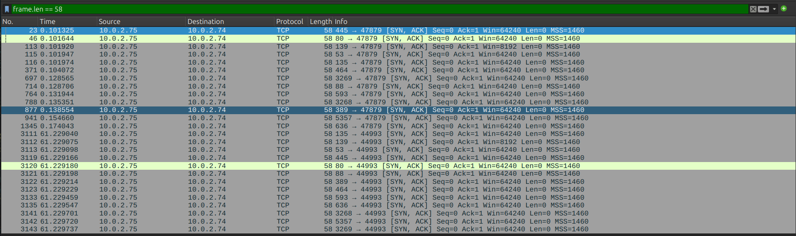
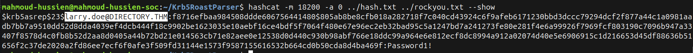
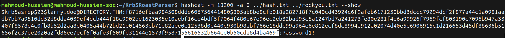
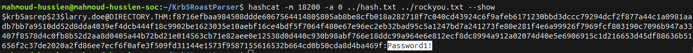
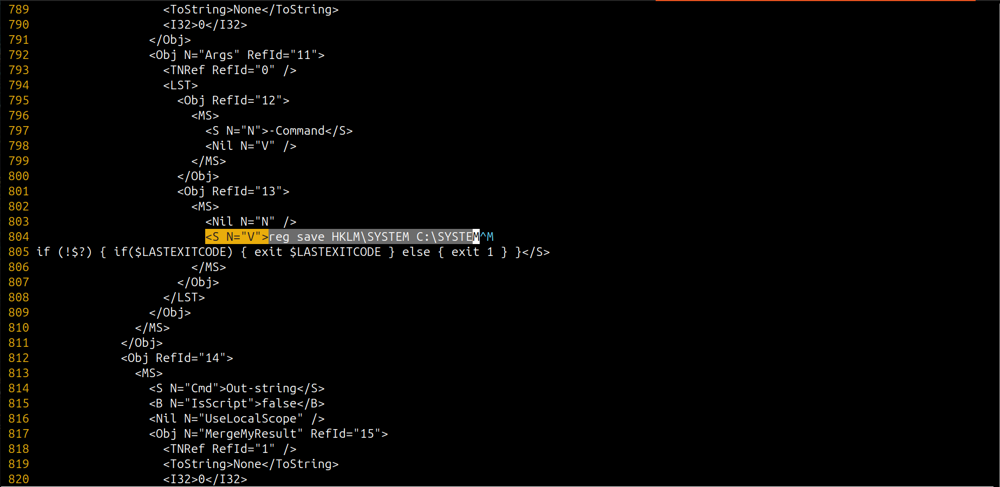
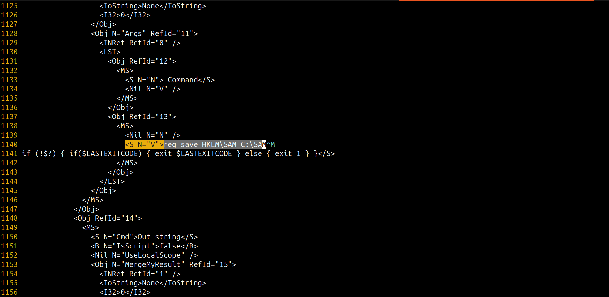
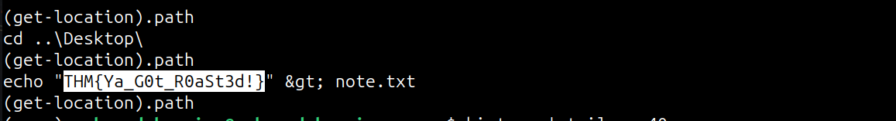

## Scenario Overview

A small music company discovered a suspicious note on Art Director Larry's Desktop. With no EDR or SIEM in place, only a Wireshark capture was available. The investigation involved 5 structured phases: port scanning analysis → AS-REP Roasting → hash cracking → WinRM traffic decryption → post-exploitation command extraction and flag retrieval.

---

## Attack Chain Overview

```
[1] Phase 1: Network Recon
    └─ Filter: frame.len == 58 (SYN-ACK responses)
    └─ Source: 10.0.2.74 → Target: 10.0.2.75
    └─ 13 open ports confirmed

[2] Phase 2: Enumeration & AS-REP Roasting
    └─ 4 valid usernames found
    └─ Target: directory.thm\larry.doe
    └─ Tool: Krb5RoastParser → AS-REP hash extracted
    └─ Hashcat -m 18200 → Password1!

[3] Phase 3: WinRM Traffic Decryption
    └─ python3 winrm_decrypt.py -p Password1!
    └─ Base64 decode → XML command blocks

[4] Phase 4: Post-Exploitation Command Analysis
    └─ reg save HKLM\SYSTEM C:\SYSTEM
    └─ reg save HKLM\SAM C:\SAM

[5] Phase 5: Flag Retrieval
    └─ cd ..\Desktop\
    └─ echo "THM{Ya_G0t_R0aSt3d!}" > note.txt
```

---

## Phase 1 — Network Reconnaissance & Port Scanning

### Wireshark Filter Used

```
frame.len == 58
```

### Investigation

Instead of filtering for SYN packets (outbound scanner traffic), the analyst applied `frame.len == 58` to isolate **incoming TCP SYN-ACK responses** from the target host (`10.0.2.75`). A SYN-ACK of exactly 58 bytes is the standard TCP handshake reply from an **open port** — this method cleanly separates confirmed open ports from all other traffic noise.

**Network Scope:**
- Source (Attacker): `10.0.2.74`
- Target (DC): `10.0.2.75` (`DIRECTORY.THM`)

**Discovered Open Ports (ascending order):**

| Port | Service |
|---|---|
| 53 | DNS |
| 80 | HTTP |
| 88 | Kerberos |
| 135 | RPC |
| 139 | NetBIOS-SSN |
| 389 | LDAP |
| 445 | SMB |
| 464 | kpasswd |
| 593 | RPC over HTTP |
| 636 | LDAPS |
| 3268 | Global Catalog |
| 3269 | Global Catalog SSL |
| 5357 | WSDAPI |

The presence of **port 88 (Kerberos)**, **389 (LDAP)**, and **445 (SMB)** immediately confirms this is a **Windows Active Directory Domain Controller** — setting the stage for AD-specific attacks.

**MITRE ATT&CK:** T1046 — Network Service Discovery

### Answer

```
53,80,88,135,139,389,445,464,593,636,3268,3269,5357
```


---

## Phase 2 — Enumeration, AS-REP Roasting & Credential Recovery

### Tool: Krb5RoastParser

**Step 1 — Clone the parser:**

```bash
git clone https://github.com/jalvarezz13/Krb5RoastParser.git
```

**Step 2 — Execute against the PCAP to isolate AS-REP tickets:**

```bash
python3 krb5_roast_parser.py ../Downloads/traffic-1725627206938.pcap as_rep
```

### Investigation

The attacker probed the domain and identified **4 valid usernames** via Kerberos pre-auth enumeration. The account `directory.thm\larry.doe` was the one that provided the initial foothold — its AS-REP ticket was successfully captured from the PCAP.

**Captured Hash Format:**

```
$krb5asrep$23$larry.doe@DIRECTORY.THM:...
```

**Hash Suffix Verification (last 30 characters):**

```
55616532b664cd0b50cda8d4ba469f
```

**Credential Cracking (Hashcat):**

```bash
hashcat -m 18200 -a 0 ../hash.txt ../rockyou.txt --show
```

- Mode `18200` = Kerberos AS-REP etype 23
- Wordlist: `rockyou.txt`
- **Recovered Plaintext Password:** `Password1!`

**MITRE ATT&CK:** T1558.003 — Steal or Forge Kerberos Tickets: Kerberoasting | T1110.002 — Password Cracking

### Answers

```
Username:      directory.thm\larry.doe
Hash (last 30): 55616532b664cd0b50cda8d4ba469f
Password:      Password1!
```




---

## Phase 3 — WinRM Traffic Decryption & Environment Setup

With valid credentials (`Password1!`) in hand, the threat actor established a remote administrative session over **Windows Remote Management (WinRM) on port 5985**. A forensic decryption pipeline was built to analyze this encrypted communication.

### A. Python Virtual Environment Configuration

```bash
python3 -m venv venv
source venv/bin/activate
pip install pyshark
pip install pycryptodome
pip install cryptography
```

### B. Decryption and Stream Parsing

**Step 1 — Decrypting the NTLM WinRM Exchange:**

```bash
python3 winrm_decrypt.py -p Password1! Downloads/traffic-1725627206938.pcap > enccmds.txt
```

**Step 2 — Filtering & Decoding Base64 PowerShell Streams:**

```bash
cat enccmds.txt | grep -o 'AAAAAAA[A-Za-z0-9+/=]\{100,\}' | base64 -d > cmds.txt
```

**Step 3 — Artifact Inspection:**

```bash
nvim cmds.txt
```

Inspected decoded structures using Neovim to isolate XML element nodes (`<S N="V">`).

---

## Phase 4 — Post-Exploitation Command Analysis & Registry Harvesting

Analysis of the decrypted command blocks exposed post-exploitation activities focused on dumping sensitive system hives:

**Command Extraction Loop:**

```bash
while read -r line; do echo "$line" | grep -a '<S N="V">' | cut -d'>' -f2 | cut -d'<' -f1; done < cmds.txt
```

**Second Executed Command:**

```
reg save HKLM\SYSTEM C:\SYSTEM
```

**Third Executed Command:**

```
reg save HKLM\SAM C:\SAM
```

**Formatted Command Sequence:**

```
reg save HKLM\SYSTEM C:\SYSTEM,reg save HKLM\SAM C:\SAM
```

**Why these commands?**

The attacker saved the `SYSTEM` and `SAM` registry hives to disk — the two files needed for offline credential extraction:
- `SAM` contains NTLM hashes of all local user accounts
- `SYSTEM` contains the boot key required to decrypt the SAM hive
- Together they enable full local credential recovery without touching LSASS

**MITRE ATT&CK:** T1003.002 — OS Credential Dumping: Security Account Manager

### Answer

```
reg save HKLM\SYSTEM C:\SYSTEM,reg save HKLM\SAM C:\SAM
```



---

## Phase 5 — Desktop Navigation & Final Flag Retrieval

**Workflow Trace (from decrypted WinRM stream):**

1. Verified current directory:
```powershell
(get-location).path
```

2. Navigated to the victim's Desktop:
```powershell
cd ..\Desktop\
```

3. Created the drop note file containing the flag:
```powershell
echo "THM{Ya_G0t_R0aSt3d!}" > note.txt
```

This confirms the "random note" discovered by Larry on his Desktop was **planted by the threat actor** after completing their post-exploitation objectives.

### Answer

```
THM{Ya_G0t_R0aSt3d!}
```


---

## Full Attack Timeline

| Phase | Action | Tool / Method |
|---|---|---|
| 1 | TCP port scan → 13 open ports | Wireshark `frame.len == 58` |
| 2 | Kerberos AS-REP Roasting → larry.doe hash | Krb5RoastParser |
| 2 | Offline hash crack → `Password1!` | Hashcat `-m 18200` |
| 3 | WinRM session established (port 5985) | Attacker RCE |
| 3 | WinRM traffic decrypted | `winrm_decrypt.py` + Python venv |
| 3 | Base64 streams decoded → XML commands | `grep` + `base64 -d` + `nvim` |
| 4 | `reg save HKLM\SYSTEM C:\SYSTEM` | WinRM shell |
| 4 | `reg save HKLM\SAM C:\SAM` | WinRM shell |
| 5 | `cd ..\Desktop\` → `echo flag > note.txt` | WinRM shell |

---

## Indicators of Compromise (IOCs)

| Type | Value | Description |
|---|---|---|
| Account | `directory.thm\larry.doe` | Compromised AD account (AS-REP Roastable) |
| Password | `Password1!` | Cracked from Kerberos AS-REP hash |
| Hash (last 30) | `55616532b664cd0b50cda8d4ba469f` | AS-REP hash fragment |
| Port | `5985/TCP` | WinRM remote access port |
| File | `C:\SYSTEM` | Dumped SYSTEM registry hive |
| File | `C:\SAM` | Dumped SAM registry hive |
| File | `C:\Users\larry\Desktop\note.txt` | Attacker-planted flag note |
| Domain | `DIRECTORY.THM` | Targeted AD domain |
| Attacker IP | `10.0.2.74` | Source of attack |
| Target IP | `10.0.2.75` | Victim Domain Controller |

---

## Forensic Tools Used

| Tool | Purpose |
|---|---|
| Wireshark (`frame.len == 58`) | Identify open ports from SYN-ACK responses |
| `Krb5RoastParser` | Extract AS-REP tickets from PCAP |
| `hashcat -m 18200` | Crack Kerberos AS-REP hash |
| `winrm_decrypt.py` | Decrypt NTLM-authenticated WinRM traffic |
| `grep` + `base64 -d` | Filter and decode Base64 PowerShell streams |
| `nvim` | Inspect decoded XML command structures |

---

## MITRE ATT&CK Mapping

| Phase | Technique ID | Technique Name |
|---|---|---|
| Discovery | T1046 | Network Service Discovery |
| Discovery | T1087.002 | Account Discovery: Domain Account |
| Credential Access | T1558.003 | AS-REP Roasting |
| Credential Access | T1110.002 | Password Cracking (Hashcat) |
| Execution | T1021.006 | Remote Services: Windows Remote Management |
| Credential Access | T1003.002 | OS Credential Dumping: SAM |
| Impact | T1491 | Defacement (note left on Desktop) |

---

## Lessons Learned

1. **Enable Kerberos pre-authentication** — Accounts with pre-auth disabled are trivially AS-REP roastable. Enable it for all accounts by default.
2. **Enforce strong password policies** — `Password1!` satisfies basic complexity rules but is in `rockyou.txt`. Require 12+ characters with no dictionary words.
3. **Restrict WinRM access** — WinRM (port 5985/5986) should be accessible only from designated jump servers, never from arbitrary hosts.
4. **Monitor `reg save` commands** — Alert on `reg save HKLM\SAM` or `reg save HKLM\SYSTEM` executed by non-Domain Admin accounts.
5. **Minimize SPN assignments** — An Art Director's account has no need for an SPN. Only accounts genuinely requiring Kerberos service tickets should have SPNs configured.

---

*Writeup produced as part of SOC Analyst training — TryHackMe: Directory*