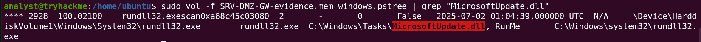
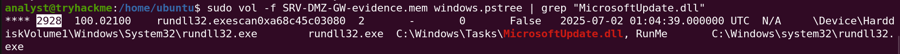
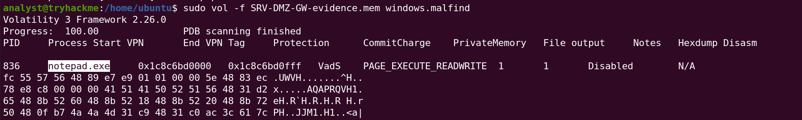
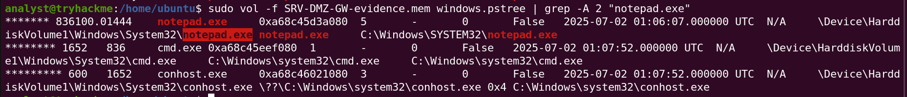
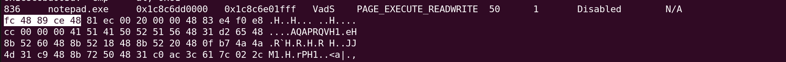
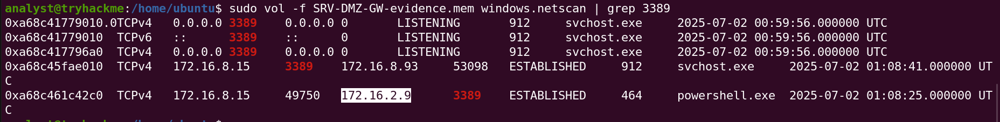

## Scenario Overview

DeceptiTech is a honeypot and deception-technology company. One morning its entire on-premises network collapsed: critical systems were encrypted, backups were corrupted and the SIEM data was wiped. This room covers the **third attack stage** of that incident.

The logs for the DMZ gateway `SRV-DMZ-GW` looked normal, but the engineering team kept reporting odd slowdowns. A memory image of the server was acquired and analyzed with Volatility 3 to find the process responsible and reconstruct what happened on the host.

---

## Attack Chain Overview

```
[1] Initial Execution (2025-07-02 01:04:39 UTC)
    └─ rundll32.exe (PID 2928)
    └─ rundll32.exe C:\windows\tasks\MicrosoftUpdate.dll, RunMe
    └─ DLL dropped in a non-standard path: C:\Windows\Tasks\

[2] Process Injection
    └─ windows.malfind flags RWX memory in notepad.exe (PID 836)
    └─ Shellcode stub starts with: fc 48 89 ce 48

[3] Interactive Shell (01:07:52 UTC)
    └─ notepad.exe (836) → cmd.exe (1652)
    └─ cmd.exe (1652) → conhost.exe (600)

[4] Lateral Movement (01:08:25 UTC)
    └─ powershell.exe (PID 464) on 172.16.8.15
    └─ RDP (TCP 3389) → 172.16.2.9
```

---

## Question 1 — What is the absolute path to the initial malicious file executed on this host?

### Volatility Command

```bash
vol -f SRV-DMZ-GW-evidence.mem windows.pstree
```

### Investigation

`windows.pstree` reconstructs the process hierarchy from the memory image. Reviewing the tree for anything that doesn't belong on a gateway server, one entry stands out: a `rundll32.exe` instance loading a DLL from `C:\Windows\Tasks\`.

| Indicator | Why it's suspicious |
|---|---|
| `C:\Windows\Tasks\` | A user/system-writable folder that legitimate DLLs are never loaded from |
| `MicrosoftUpdate.dll` | The name imitates a Windows update component |

The attacker used a trusted name and a quiet, writable location so the file blends in with normal system activity.

**MITRE ATT&CK:** T1036.005 — Masquerading: Match Legitimate Name or Location

### Answer

```
C:\Windows\Tasks\MicrosoftUpdate.dll
```


---

## Question 2 — Which process ID was assigned to the process used to execute the initial payload?

### Volatility Command

```bash
vol -f SRV-DMZ-GW-evidence.mem windows.pstree
```

### Investigation

From the same `windows.pstree` output, the process that loaded `MicrosoftUpdate.dll` is `rundll32.exe`:

| Field | Value |
|---|---|
| Process | `rundll32.exe` |
| PID | `2928` |
| Created | `2025-07-02 01:04:39 UTC` |

`rundll32.exe` is a legitimate Windows binary used to run functions exported from DLL files. Attackers abuse it as a **Living-off-the-Land binary (LOLBin)** so the malicious code runs under a trusted, signed process.

**MITRE ATT&CK:** T1218.011 — System Binary Proxy Execution: Rundll32

### Answer

```
2928
```


---

## Question 3 — What was the full command line used to launch initial execution?

### Volatility Command

```bash
sudo vol -f SRV-DMZ-GW-evidence.mem windows.cmdline | grep "MicrosoftUpdate.dll"
```

### Investigation

`windows.cmdline` prints the full command-line arguments of every process in the image. Filtering for the DLL name returns the exact invocation:

```
rundll32.exe C:\windows\tasks\MicrosoftUpdate.dll, RunMe
```

**Command breakdown:**

| Component | Meaning |
|---|---|
| `rundll32.exe` | Windows utility for calling functions exported by a DLL |
| `C:\windows\tasks\MicrosoftUpdate.dll` | The malicious DLL |
| `RunMe` | The exported function used as the entry point |

An exported function named `RunMe` is a strong sign this DLL was built purely to be launched this way.

### Answer

```
rundll32.exe C:\windows\tasks\MicrosoftUpdate.dll, RunMe
```


---

## Question 4 — What is the name of the final process in the chain?

### Volatility Commands

```bash
sudo vol -f SRV-DMZ-GW-evidence.mem windows.malfind
sudo vol -f SRV-DMZ-GW-evidence.mem windows.pstree | grep -A 2 "notepad.exe"
```

### Investigation

**Step 1 — Find injected code.** `windows.malfind` scans each process for memory regions that are both executable and writable and not backed by a file on disk, the classic mark of injected code. It flagged a region in `notepad.exe`:

| Field | Value |
|---|---|
| Process | `notepad.exe` |
| PID | `836` |
| Protection | `PAGE_EXECUTE_READWRITE` |

A Notepad process has no reason to hold executable, writable memory, so the payload injected itself into a legitimate process rather than running as an obvious standalone binary.



**Step 2 — Check what it spawned.** `grep -A 2` on `notepad.exe` shows its children in the process tree:

```
notepad.exe  (PID 836)
  └─ cmd.exe      (PID 1652)  — 2025-07-02 01:07:52 UTC
       └─ conhost.exe (PID 600)  — 2025-07-02 01:07:52 UTC
```

Notepad spawning `cmd.exe` is highly abnormal and shows the injected code was used to open an interactive command shell on the host.

**MITRE ATT&CK:** T1055 — Process Injection | T1059.003 — Windows Command Shell

### Answer

```
notepad.exe
```


---

## Question 5 — What are the first five bytes (hex) of the Meterpreter shellcode injected into it?

### Volatility Command

```bash
sudo vol -f SRV-DMZ-GW-evidence.mem windows.malfind
```

### Investigation

For each flagged region, `windows.malfind` prints a hex dump of the first bytes. In the `notepad.exe` (PID 836) region the dump starts with:

```
fc 48 89 ce 48
```

Decoded as x64 instructions:

| Bytes | Instruction |
|---|---|
| `fc` | `cld` |
| `48 89 ce` | `mov rsi, rcx` |
| `48 ...` | Start of the next instruction (REX.W prefix) |

These bytes begin with `cld` and then set up registers. That is the shape of a position-independent shellcode stub, and the room identifies this payload as Meterpreter. Because the bytes sit in RWX memory inside a process that should never contain them, they are consistent with a staged Metasploit payload injected into `notepad.exe`.

### Answer

```
fc4889ce48
```


---

## Question 6 — Which IP address do the hosts use for lateral movement over port 3389?

### Volatility Command

```bash
sudo vol -f SRV-DMZ-GW-evidence.mem windows.netscan | grep 3389
```

### Investigation

`windows.netscan` carves network connection structures out of memory. Filtering for port `3389` (RDP) shows an outbound Remote Desktop connection from the gateway to an internal host:

| Field | Value |
|---|---|
| Source | `172.16.8.15` (`SRV-DMZ-GW`) |
| Destination | `172.16.2.9` |
| Port | `3389/TCP` (RDP) |
| Owner process | `powershell.exe` (PID `464`) |
| Timestamp | `2025-07-02 01:08:25 UTC` |

A DMZ gateway initiating RDP to an internal server is the pivot from the DMZ into the internal network. The connection came about 33 seconds after `cmd.exe` was spawned (01:07:52 → 01:08:25), so the attacker moved on almost immediately after getting a shell.

**MITRE ATT&CK:** T1021.001 — Remote Services: Remote Desktop Protocol

### Answer

```
172.16.2.9
```


---

## Full Attack Timeline

| Time (UTC, 2025-07-02) | PID | Event |
|---|---|---|
| 01:04:39 | 2928 | `rundll32.exe` runs `MicrosoftUpdate.dll,RunMe` |
| Between 01:04:39 and 01:07:52 | 836 | Shellcode injected into `notepad.exe` (RWX region found by `malfind`) |
| 01:07:52 | 1652 | `notepad.exe` spawns `cmd.exe` |
| 01:07:52 | 600 | `cmd.exe` spawns `conhost.exe` |
| 01:08:25 | 464 | `powershell.exe` opens RDP (3389) from `172.16.8.15` to `172.16.2.9` |

---

## Indicators of Compromise (IOCs)

| Type | Value | Description |
|---|---|---|
| File | `C:\Windows\Tasks\MicrosoftUpdate.dll` | Malicious DLL (exports `RunMe`) |
| Command line | `rundll32.exe C:\windows\tasks\MicrosoftUpdate.dll, RunMe` | Initial execution |
| Process | `rundll32.exe` (PID 2928) | LOLBin used to load the DLL |
| Process | `notepad.exe` (PID 836) | Injection target |
| Process | `cmd.exe` (PID 1652) | Shell spawned from `notepad.exe` |
| Process | `conhost.exe` (PID 600) | Console host for `cmd.exe` |
| Process | `powershell.exe` (PID 464) | Owner of the outbound RDP connection |
| Memory | `PAGE_EXECUTE_READWRITE` region in `notepad.exe` | Injected shellcode |
| Bytes | `fc 48 89 ce 48` | First five bytes of the injected shellcode |
| IP | `172.16.8.15` | Compromised host (`SRV-DMZ-GW`) |
| IP:Port | `172.16.2.9:3389` | Internal RDP lateral movement target |

---

## Volatility Commands Reference

```bash
# Q1 / Q2: Process tree (suspicious rundll32, PIDs, parent-child chain)
vol -f SRV-DMZ-GW-evidence.mem windows.pstree

# Q3: Full command line of the initial execution
sudo vol -f SRV-DMZ-GW-evidence.mem windows.cmdline | grep "MicrosoftUpdate.dll"

# Q4 / Q5: Injected code (RWX regions + hex dump of first bytes)
sudo vol -f SRV-DMZ-GW-evidence.mem windows.malfind

# Q4: Children spawned by notepad.exe
sudo vol -f SRV-DMZ-GW-evidence.mem windows.pstree | grep -A 2 "notepad.exe"

# Q6: RDP connections
sudo vol -f SRV-DMZ-GW-evidence.mem windows.netscan | grep 3389
```

---

## MITRE ATT&CK Mapping

| Phase | Technique ID | Technique Name |
|---|---|---|
| Defense Evasion | T1036.005 | Masquerading: Match Legitimate Name or Location |
| Defense Evasion | T1218.011 | System Binary Proxy Execution: Rundll32 |
| Defense Evasion / Privilege Escalation | T1055 | Process Injection |
| Execution | T1059.003 | Command and Scripting Interpreter: Windows Command Shell |
| Lateral Movement | T1021.001 | Remote Services: Remote Desktop Protocol |

---

## Recommendations

1. **Alert on `rundll32.exe` loading DLLs from user-writable paths** — `C:\Windows\Tasks\`, `%TEMP%` and `%APPDATA%` should never host DLLs that `rundll32.exe` runs.
2. **Alert on odd parent-child relationships** — `notepad.exe` spawning `cmd.exe` is a high-confidence injection indicator.
3. **Detect RWX memory in common processes** — EDR rules for `PAGE_EXECUTE_READWRITE` regions in processes like Notepad catch injection early.
4. **Block outbound RDP from the DMZ** — A DMZ gateway has no reason to open RDP sessions into the internal network. Segment and enforce that with firewall rules.
5. **Restrict writes to `C:\Windows\Tasks\`** — Use application control (AppLocker/WDAC) so binaries and DLLs can't be dropped and executed from there.
6. **Capture memory early in IR** — The logs on this server looked normal; the memory image was what exposed the injected process and the pivot.

---

*Writeup produced as part of SOC Analyst training — TryHackMe: Lost in RAMslation*