## Scenario Overview

Vantage Dynamics' IT team escalated a report from Accounts Payable: an employee, **Marcus Webb**, noticed a colleague referencing a document tied to his account that he had no memory of sending. Around the same time, a second employee's account, **David Chen**, started showing unusual activity.

The task was to determine how the intrusion began, how it spread between accounts, and whether any sensitive data left the organization. Three Microsoft 365 log sources were used:

| Sourcetype | Content |
|---|---|
| `o365:graph:api` | Entra ID / Azure AD sign-in logs |
| `o365:management:activity` | Unified audit log (Exchange, SharePoint, Teams) |
| `o365:reporting:messagetrace` | Exchange message trace |

> **Analyst note from the briefing:** every employee is issued a company-managed MacBook, so a non-macOS sign-in is the baseline anomaly. Marcus also messages and shares files constantly, so each message or share has to be checked against the account's normal behavior before being treated as part of the incident.

---

## Attack Chain Overview

```
[1] Initial Access (Marcus Webb)
    └─ 2026-08-27 12:28:31 — first non-macOS sign-in
    └─ Windows 10 / Chrome 120 from 185.220.101.47 (Roosendaal)

[2] Mailbox Collection
    └─ 22 emails accessed in 4 MailItemsAccessed events (12:28:40 → 12:29:55)

[3] Persistence / Defense Evasion
    └─ Inbox rule "update" created at 12:30:10
    └─ Subject contains "invoice" → DeleteMessage + StopProcessingRules

[4] Rule Triggered
    └─ 12:41:09 — reply "RE: Meridian invoice batch - please confirm"
    └─ 10 minutes 59 seconds after rule creation

[5] Internal Propagation
    └─ 13:03:38 — Teams message from Marcus with link to Meridian_Invoice_Batch_Aug2026.pdf

[6] Second Account Compromised (David Chen)
    └─ 13:27:04 — Linux sign-in from 91.219.237.88
    └─ 23 minutes 26 seconds after the Teams message

[7] Data Access & External Sharing
    └─ 13:28:31 — Q4_Board_Financial_Summary.xlsx downloaded
    └─ 14:52:44 — Vendor_Onboarding_Notes.docx shared with d.reynolds88@protonmail.com
```

---

## Objective 01 — How was Marcus Webb's account initially compromised?

### Q1 — What is the first timestamp at which a non-macOS device signed into Marcus Webb's account?

**SPL Query:**

```spl
index="vantage" sourcetype="o365:graph:api" userPrincipalName="marcus.webb@vantagedynamics.onmicrosoft.com"
| table _time, appDisplayName, deviceDetail.browser, deviceDetail.operatingSystem, location.city, ipAddress
| sort _time
```

**Investigation:**

The sign-in logs for Marcus's account were sorted chronologically and reviewed for deviations from his baseline of a company-managed MacBook. The first sign-in that doesn't match that baseline:

| Field | Value |
|---|---|
| Timestamp | `2026-08-27 12:28:31` |
| IP Address | `185.220.101.47` |
| City | Roosendaal |
| OS | Windows 10 |
| Browser | Chrome 120.0.0 |

A Windows device sitting in a fleet of MacBooks, in a different location, is the entry point. The logs record the sign-in itself; they do not show how the attacker obtained the credentials.

**MITRE ATT&CK:** T1078.004 — Valid Accounts: Cloud Accounts

**Answer:**

```
2026-08-27 12:28:31
```
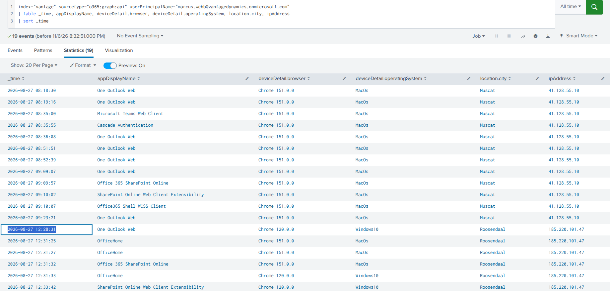

---

## Objective 02 — What did the attacker do immediately after gaining access?

### Q2 — How many emails were accessed within the first few minutes of the session?

**SPL Query:**

```spl
index="vantage" sourcetype="o365:management:activity" user_id="marcus.webb@vantagedynamics.onmicrosoft.com" Operation=MailItemsAccessed earliest="08/27/2026:12:28:31" latest="08/27/2026:14:28:31"
| sort _time
| table _time, OperationCount, ClientIPAddress, Folders{}.FolderItems{}.Subject, Folders{}.Path
```

**Investigation:**

The `MailItemsAccessed` audit events were filtered to the window starting at the first suspicious sign-in. Four events were recorded:

| Time | Client IP | Items | Folder(s) |
|---|---|---|---|
| 12:28:40 | `185.220.101.47` | 6 | `\Inbox` |
| 12:28:43 | `185.220.101.47` | 2 | `\Inbox` |
| 12:28:53 | `185.220.101.47` | 8 | `\Inbox`, `\Sent Items` |
| 12:29:55 | `2603:10b6:930:30::7` | 6 | `\Inbox` |
| **Total** | | **22** | |

```
6 + 2 + 8 + 6 = 22
```

Access to `\Sent Items` in addition to `\Inbox` suggests the attacker was reading both incoming and outgoing correspondence to understand the account's normal business context. Note that the last event came from a different client IP than the first three; all four fall inside the same window and are counted in the total.

**MITRE ATT&CK:** T1114.002 — Email Collection: Remote Email Collection

**Answer:**

```
22
```
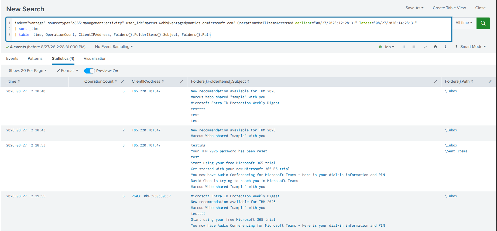

---

## Objective 03 — What persistence mechanism was left on the mailbox?

### Q3 — What subject line does the attacker's inbox rule match on?

**SPL Query:**

```spl
index="vantage" sourcetype="o365:management:activity" user_id="marcus.webb@vantagedynamics.onmicrosoft.com" Operation="New-InboxRule" earliest="08/27/2026:12:28:31" latest="08/27/2026:14:28:31"
| table _time, Name, Parameters{}.Name, Parameters{}.Value, SubjectContainsWords
```

**Investigation:**

A `New-InboxRule` event was recorded about 100 seconds after the mailbox collection finished:

| Field | Value |
|---|---|
| Created | `2026-08-27 12:30:10` |
| Rule Name | `update` |
| SubjectContainsWords | `invoice` |
| DeleteMessage | `True` |
| StopProcessingRules | `True` |
| AlwaysDeleteOutlookRulesBlob | `False` |

The rule name `update` is deliberately bland so it blends in with routine mailbox rules. Its function is concealment: any incoming message with "invoice" in the subject is deleted before Marcus sees it. That lets the attacker carry on a conversation about invoices from his mailbox without the real owner noticing replies.

**MITRE ATT&CK:** T1564.008 — Hide Artifacts: Email Hiding Rules

**Answer:**

```
invoice
```
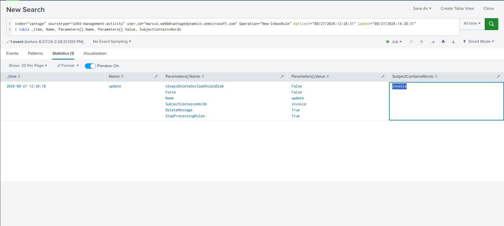

---

### Q4 — How much time elapsed between the rule being created and a matching reply arriving?

**SPL Query:**

```spl
index="vantage" sourcetype="o365:reporting:messagetrace" Subject=*invoice* earliest="08/27/2026:12:28:31" latest="08/27/2026:14:28:31"
| table _time, FromIP, Subject, SenderAddress, RecipientAddress
```

**Investigation:**

The message trace shows the first matching email landing in Marcus's mailbox after the rule was in place:

| Field | Value |
|---|---|
| Sender | `finance-team@vantagedynamics.onmicrosoft.com` |
| Recipient | `marcus.webb@vantagedynamics.onmicrosoft.com` |
| Subject | `RE: Meridian invoice batch - please confirm` |
| Source IP | `40.107.20.73` |
| Arrival | `2026-08-27 12:41:09` |

**Calculation:**

```
Rule created:      2026-08-27 12:30:10
Matching reply:    2026-08-27 12:41:09
Elapsed:           10 minutes 59 seconds
```

The subject line shows the Finance team was replying to something sent from Marcus's account about a "Meridian invoice batch", which means the attacker was already conducting an invoice-themed conversation from the compromised mailbox.

**Answer:**

```
10 minutes 59 seconds
```
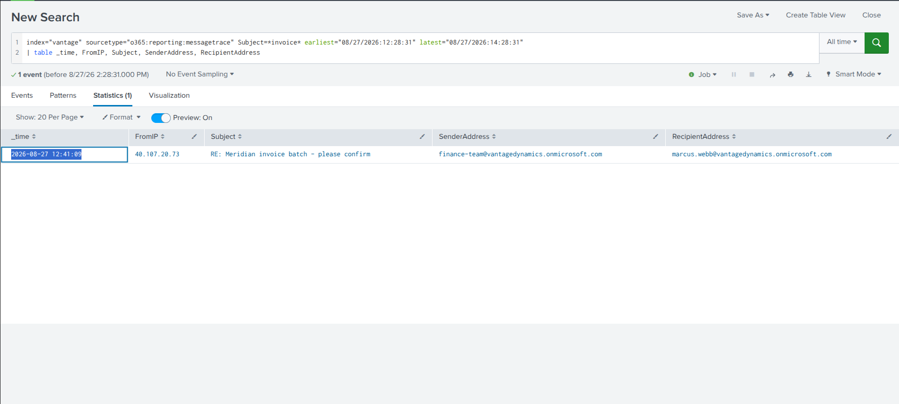

---

## Objective 04 — How did the attacker move to a second identity?

### Q5 — What file did the link in Marcus Webb's Teams message reference?

**SPL Query:**

```spl
index="vantage" sourcetype="o365:management:activity" Operation="MessageCreatedHasLink" earliest="08/27/2026:12:28:31" latest="08/27/2026:14:28:31"
| table _time, MessageFiles{}.FileUrl
```

**Investigation:**

`MessageCreatedHasLink` events capture Teams messages that contain a link. Within the incident window, one message was created from Marcus's account at `2026-08-27 13:03:38` referencing:

```
https://vantagedynamics.sharepoint.com/Shared%20Documents/Meridian_Invoice_Batch_Aug2026.pdf
```

The file name ties back to the invoice-themed lure from the mailbox phase. Marcus never remembered sending it, which is exactly what Accounts Payable reported.

**MITRE ATT&CK:** T1534 — Internal Spearphishing

**Answer:**

```
Meridian_Invoice_Batch_Aug2026.pdf
```
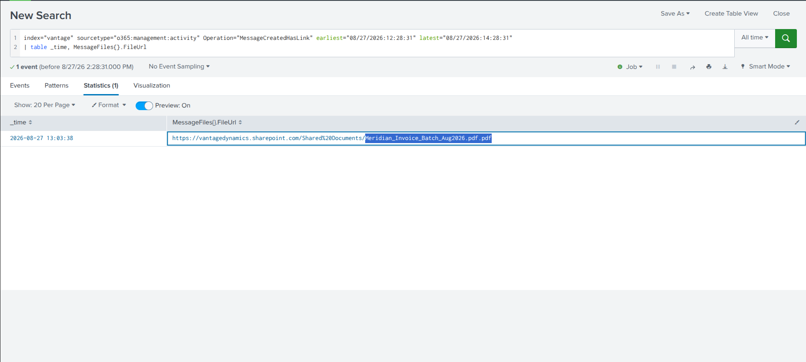

---

### Q6 — What operating system was used in the suspicious sign-in to David Chen's account?

**SPL Query:**

```spl
index="vantage" sourcetype="o365:graph:api" userPrincipalName="david.chen@vantagedynamics.onmicrosoft.com"
| table _time, ipAddress, appDisplayName, deviceDetail.browser, deviceDetail.operatingSystem, location.city
| sort - _time
```

**Investigation:**

David's sign-ins were reviewed against the same baseline question: does the device fit a company-managed MacBook? One sign-in does not:

| Field | Value |
|---|---|
| Time | `2026-08-27 13:27:04` |
| OS | `Linux` |
| IP | `91.219.237.88` |

**MITRE ATT&CK:** T1078.004 — Valid Accounts: Cloud Accounts

**Answer:**

```
Linux
```
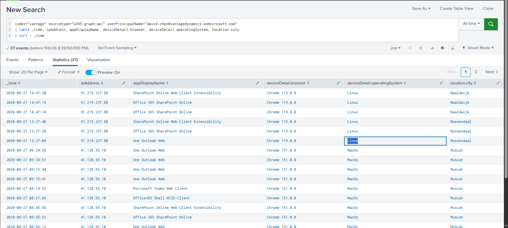

---

### Q7 — What IP address was used in this same sign-in?

From the same record:

**Answer:**

```
91.219.237.88
```
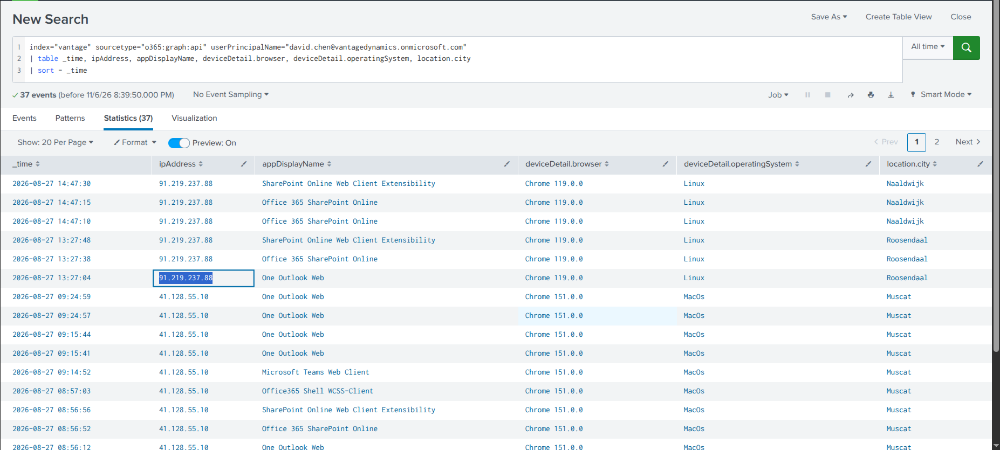

---

### Q8 — How much time passed between the Teams message being created and the suspicious sign-in?

**Investigation:**

Combining the Teams message creation time (Q5) with the sign-in time (Q6):

```
Teams message created:   2026-08-27 13:03:38
David Chen sign-in:      2026-08-27 13:27:04
Elapsed:                 23 minutes 26 seconds
```

The sign-in to David's account came from different infrastructure than Marcus's (a different IP and a different OS), and happened shortly after the link was distributed. That timing fits the link being used to capture David's credentials.

**Answer:**

```
23 minutes 26 seconds
```

---

## Objective 05 — What sensitive data was accessed, and did it leave the organization?

### Q9 — The file the attacker downloaded was legitimately modified earlier that day. At what time?

**SPL Query:**

```spl
index="vantage" sourcetype="o365:management:activity" "*Q4_Board_Financial_Summary.xlsx"
| table _time, ClientIP, action, Operation, UserId
| sort - _time
```

**Investigation:**

Searching every audit event that references `Q4_Board_Financial_Summary.xlsx` gives the full history of the file that day, including the attacker's download:

| Time | Client IP | User | Meaning |
|---|---|---|---|
| `2026-08-27 08:27:03` | internal | legitimate user | **Legitimate modification** |
| `2026-08-27 13:28:31` | `91.219.237.88` | `david.chen@vantagedynamics.onmicrosoft.com` | **Attacker download** |

The attacker's download came about 77 seconds after the sign-in to David's account (13:27:04 → 13:28:31), so the Leadership document was clearly the target.

**MITRE ATT&CK:** T1530 — Data from Cloud Storage

**Answer:**

```
2026-08-27 08:27:03
```
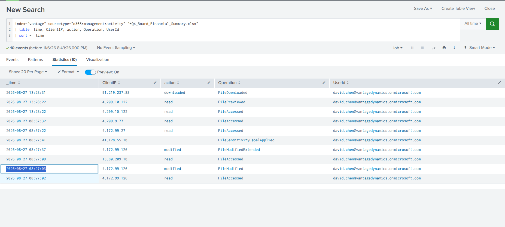

---

### Q10 — What file on the Leadership site had a sensitivity label applied by data governance before the incident?

**SPL Query:**

```spl
index="vantage" sourcetype="o365:management:activity" Operation="FileSensitivityLabelApplied"
| table _time, ApplicationDisplayName, DestinationFileName, object_path
```

**Investigation:**

`FileSensitivityLabelApplied` events show which documents the organization had classified. The label for the board financial summary was applied the same morning, before the intrusion began (`2026-08-27 08:27:41`, via WebExcel), on:

```
https://vantagedynamics.sharepoint.com/sites/Leadership/Shared Documents/Q4_Board_Financial_Summary.xlsx
```

That is the same file the attacker downloaded in Q9. The sensitivity label did not stop the download, because it classifies the content rather than preventing access from a compromised identity.

**Answer:**

```
Q4_Board_Financial_Summary.xlsx
```
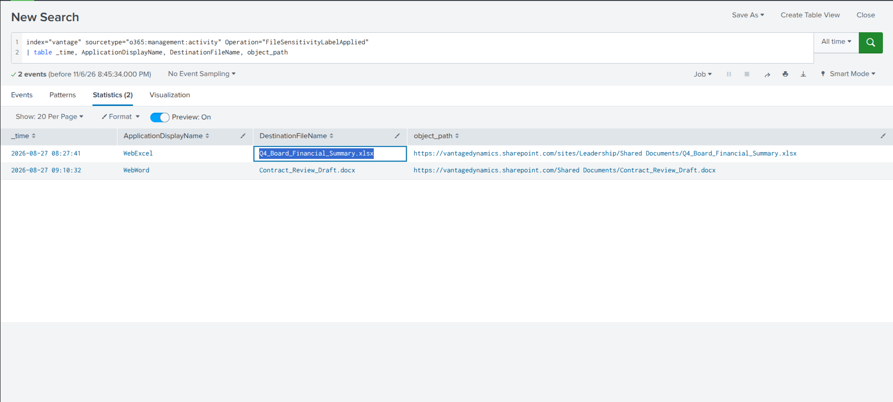

---

### Q11 — What file did the attacker create an external sharing link for?

**SPL Query:**

```spl
index="vantage" sourcetype="o365:management:activity" Operation="SharingSet"
| table _time, ClientIP, file_name, file_path, user_id, TargetUserOrGroupName
```

**Investigation:**

`SharingSet` events record permissions being granted on a file. The suspicious one:

| Field | Value |
|---|---|
| Time | `2026-08-27 14:52:44` |
| Actor | `david.chen@vantagedynamics.onmicrosoft.com` |
| Client IP | `91.219.237.88` (the attacker's IP) |
| File | `Vendor_Onboarding_Notes.docx` |
| Target | `d.reynolds88@protonmail.com` |

The attacker's IP appears as the client on this action, which confirms it was performed by the attacker using David's account and not by David himself.

**MITRE ATT&CK:** T1537 — Transfer Data to Cloud Account

**Answer:**

```
Vendor_Onboarding_Notes.docx
```
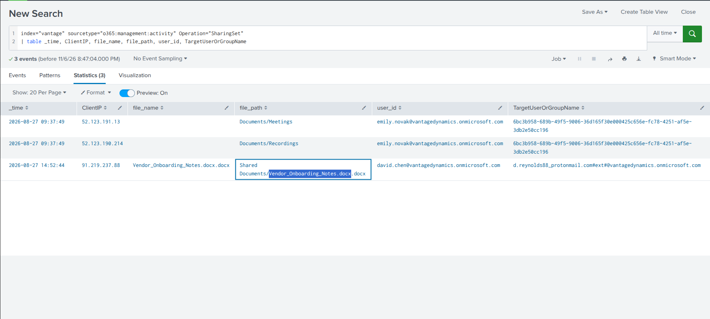

---

### Q12 — What external email address was granted access to this file?

From the same `SharingSet` event (`TargetUserOrGroupName`):

**Answer:**

```
d.reynolds88@protonmail.com
```
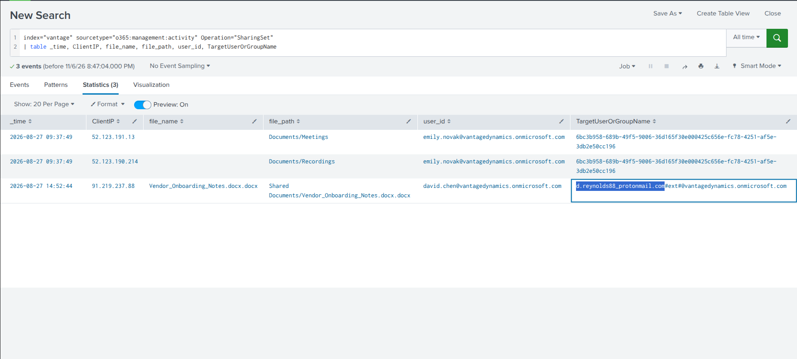

---

### Q13 — What is the subject line of the notification sent to this external address by the sharing application?

**SPL Query:**

```spl
index="vantage" sourcetype="o365:reporting:messagetrace" RecipientAddress="d.reynolds88@protonmail.com"
| table _time, src_user, Subject
```

**Investigation:**

The message trace confirms the share actually went out to the external recipient:

| Field | Value |
|---|---|
| Time | `2026-08-27 14:52:44` |
| Sender | `no-reply@sharepointonline.com` |
| Recipient | `d.reynolds88@protonmail.com` |
| Subject | `David Chen shared "Vendor_Onboarding_Notes.docx" with you` |

**Answer:**

```
David Chen shared "Vendor_Onboarding_Notes.docx" with you
```


---

## Full Attack Timeline

| Time (2026-08-27) | Account | Event |
|---|---|---|
| 08:27:03 | — | `Q4_Board_Financial_Summary.xlsx` legitimately modified |
| 08:27:41 | — | Sensitivity label applied to the same file (WebExcel) |
| **12:28:31** | Marcus Webb | First non-macOS sign-in (Windows 10 / Chrome 120, `185.220.101.47`) |
| 12:28:40 – 12:29:55 | Marcus Webb | 22 emails accessed across 4 `MailItemsAccessed` events |
| **12:30:10** | Marcus Webb | Inbox rule `update` created (subject contains `invoice` → delete) |
| 12:41:09 | Marcus Webb | Matching reply arrives (`RE: Meridian invoice batch - please confirm`) |
| **13:03:38** | Marcus Webb | Teams message with link to `Meridian_Invoice_Batch_Aug2026.pdf` |
| **13:27:04** | David Chen | Suspicious Linux sign-in from `91.219.237.88` |
| 13:28:31 | David Chen | `Q4_Board_Financial_Summary.xlsx` downloaded by the attacker |
| **14:52:44** | David Chen | `Vendor_Onboarding_Notes.docx` shared externally with `d.reynolds88@protonmail.com` |

---

## Indicators of Compromise (IOCs)

| Type | Value | Description |
|---|---|---|
| Account | `marcus.webb@vantagedynamics.onmicrosoft.com` | Initially compromised account |
| Account | `david.chen@vantagedynamics.onmicrosoft.com` | Secondary compromised account |
| IP | `185.220.101.47` | Attacker sign-in IP, Marcus (Roosendaal) |
| IP | `91.219.237.88` | Attacker IP, David (sign-in, download, external share) |
| Device | Windows 10 / Chrome 120.0.0 | Non-baseline device on Marcus's account |
| Device | Linux | Non-baseline device on David's account |
| Inbox Rule | `update` | Deletes mail with "invoice" in the subject |
| URL | `https://vantagedynamics.sharepoint.com/Shared%20Documents/Meridian_Invoice_Batch_Aug2026.pdf` | Link distributed via Teams |
| File | `Q4_Board_Financial_Summary.xlsx` | Sensitive file downloaded by the attacker |
| File | `Vendor_Onboarding_Notes.docx` | File shared with an external address |
| Email | `d.reynolds88@protonmail.com` | External recipient of the shared file |

---

## Splunk Queries Reference

```spl
-- Q1: Marcus Webb sign-in history (baseline deviation)
index="vantage" sourcetype="o365:graph:api" userPrincipalName="marcus.webb@vantagedynamics.onmicrosoft.com"
| table _time, appDisplayName, deviceDetail.browser, deviceDetail.operatingSystem, location.city, ipAddress
| sort _time

-- Q2: Mailbox items accessed after the suspicious sign-in
index="vantage" sourcetype="o365:management:activity" user_id="marcus.webb@vantagedynamics.onmicrosoft.com" Operation=MailItemsAccessed earliest="08/27/2026:12:28:31" latest="08/27/2026:14:28:31"
| sort _time
| table _time, OperationCount, ClientIPAddress, Folders{}.FolderItems{}.Subject, Folders{}.Path

-- Q3: Malicious inbox rule
index="vantage" sourcetype="o365:management:activity" user_id="marcus.webb@vantagedynamics.onmicrosoft.com" Operation="New-InboxRule" earliest="08/27/2026:12:28:31" latest="08/27/2026:14:28:31"
| table _time, Name, Parameters{}.Name, Parameters{}.Value, SubjectContainsWords

-- Q4: Matching message arriving after the rule
index="vantage" sourcetype="o365:reporting:messagetrace" Subject=*invoice* earliest="08/27/2026:12:28:31" latest="08/27/2026:14:28:31"
| table _time, FromIP, Subject, SenderAddress, RecipientAddress

-- Q5 / Q8: Teams message containing a link
index="vantage" sourcetype="o365:management:activity" Operation="MessageCreatedHasLink" earliest="08/27/2026:12:28:31" latest="08/27/2026:14:28:31"
| table _time, MessageFiles{}.FileUrl

-- Q6 / Q7: David Chen sign-in history
index="vantage" sourcetype="o365:graph:api" userPrincipalName="david.chen@vantagedynamics.onmicrosoft.com"
| table _time, ipAddress, appDisplayName, deviceDetail.browser, deviceDetail.operatingSystem, location.city
| sort - _time

-- Q9: History of the targeted file
index="vantage" sourcetype="o365:management:activity" "*Q4_Board_Financial_Summary.xlsx"
| table _time, ClientIP, action, Operation, UserId
| sort - _time

-- Q10: Files with a sensitivity label
index="vantage" sourcetype="o365:management:activity" Operation="FileSensitivityLabelApplied"
| table _time, ApplicationDisplayName, DestinationFileName, object_path

-- Q11 / Q12: External sharing
index="vantage" sourcetype="o365:management:activity" Operation="SharingSet"
| table _time, ClientIP, file_name, file_path, user_id, TargetUserOrGroupName

-- Q13: Notification sent to the external address
index="vantage" sourcetype="o365:reporting:messagetrace" RecipientAddress="d.reynolds88@protonmail.com"
| table _time, src_user, Subject
```

---

## MITRE ATT&CK Mapping

| Phase | Technique ID | Technique Name | Evidence |
|---|---|---|---|
| Initial Access | T1078.004 | Valid Accounts: Cloud Accounts | Non-macOS sign-ins on Marcus and David |
| Collection | T1114.002 | Email Collection: Remote Email Collection | 22 `MailItemsAccessed` items |
| Defense Evasion | T1564.008 | Hide Artifacts: Email Hiding Rules | Inbox rule `update` |
| Lateral Movement | T1534 | Internal Spearphishing | Teams link to `Meridian_Invoice_Batch_Aug2026.pdf` |
| Collection | T1530 | Data from Cloud Storage | Download of `Q4_Board_Financial_Summary.xlsx` |
| Exfiltration | T1537 | Transfer Data to Cloud Account | `SharingSet` to an external ProtonMail address |

---

## Recommendations

1. **Revoke sessions and reset credentials for both accounts** — Revoke all refresh tokens for `marcus.webb` and `david.chen`, force a password reset, and re-register MFA methods. Resetting the password alone doesn't kill existing sessions.
2. **Remove the `update` inbox rule** — Search every mailbox for rules that delete or redirect mail and review the ones created in the last few days.
3. **Revoke the external share** — Remove the sharing link on `Vendor_Onboarding_Notes.docx` for `d.reynolds88@protonmail.com`, and restrict external sharing on the Leadership site.
4. **Treat the board summary as disclosed** — `Q4_Board_Financial_Summary.xlsx` was downloaded by an attacker. Notify leadership and legal and assess regulatory obligations, since this is a financial services client.
5. **Require compliant devices through Conditional Access** — Every employee has a managed MacBook, so a policy that allows sign-in only from compliant or managed devices would have blocked both the Windows and Linux sign-ins.
6. **Alert on baseline deviations** — Alert on sign-ins from an OS not seen for that user, and on new inbox rules that delete messages or use `StopProcessingRules`.
7. **Alert on bursts of `MailItemsAccessed`** — 22 items in about 90 seconds from a new device is far above normal reading behavior.
8. **Monitor external sharing by guests and new accounts** — Alert when `SharingSet` targets an external domain from an IP the user has never used.
9. **Warn staff about internal phishing** — The Teams link came from a trusted colleague's real account. Staff should verify unexpected invoice links out-of-band.

---

*Writeup produced as part of SOC Analyst training — TryHackMe: The O365 Intrusion*